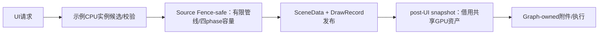
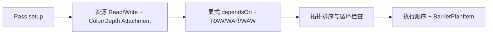

# RenderPass、RenderGraph 与执行器设计

核对日期：2026-10-11（C现有API/生命周期审计，无代码修改）。

源码：[RenderPass](../../src/KuEngine/Render/RenderPass.h)、[RenderContext](../../src/KuEngine/Render/RenderContext.h)、[RenderGraph](../../src/KuEngine/Render/RenderGraph.h)、[RenderPipeline](../../src/KuEngine/Render/RenderPipeline.cpp)。

## 生命周期

RenderPipeline通过unique_ptr持有Pass。compile(context)初始化/注册/调用setup(builder)，编译依赖与执行顺序、构建candidate pool，再调用prepare(context)，全部成功才发布Graph/pool。Pass自身GPU准备是否候选式发布取决于实现；Probe Compute reset-then-build不承诺transactional live recovery。

| 接口 | 当前职责 |
|---|---|
| name() | 节点名称 |
| initialize(const RenderContext&) | 按实际格式和设备能力创建资源 |
| setup(RenderGraphBuilder&) | 声明资源、附件和依赖 |
| prepare(const RenderContext&) | Graph编译/pool候选后准备依赖声明的GPU对象 |
| update(const FrameData&) | 更新每帧业务数据 |
| execute(CommandList&, const FrameData&) | 记录业务命令 |
| execute(CommandList&, const FrameData&, RenderGraphResourceResolver&) | typed use/range解析后记录业务命令；默认转发兼容两参数execute |
| drawUI() | 仅构建该 Pass 的参数内容；不创建独立顶层窗口 |
| onResize(width, height) | 更新尺寸相关数据 |
| enabled() / setEnabled() | 控制 update/execute 是否运行 |

兼容的无参 setup() 仍存在，默认 builder 版本会调用它。没有 shutdown() 接口，清理由析构完成。Pass enabled 改变不会重新编译 Graph；附件的内容依赖仍需满足执行约束。

Mclaren UI/CLI 请求入队，`update()` 在 Engine 等待单帧 Fence、acquire 后、录制前构建/发布完整替换候选；失败保留 live state。resize 跳过帧保留请求。两示例的 ScenePrepare `execute()` 位于本帧 UI 后，生成稳定 snapshot；所有 scene consumer 显式 dependsOn prepare 并检查 disabled/stale。Background → Forward Opaque/Mask 或 Geometry/Lighting → Forward Blend →唯一 Display → RuntimeOverlay；两路径共享 RGBA16F SceneColor/Depth，Geometry/Opaque Depth STORE→Blend LOAD/test/no-write。各 phase 独立 Renderer UBO，长期资产仍由 coordinator 拥有。首次 initialize 加载资产，ready 后 recompile 保留资产/相机/UI；格式相关 Display/Lighting candidate 成功才发布。依赖单帧 Fence-safe/idle，不是多帧 retire。

## 初始化契约

Mclaren实例编辑也只在UI排队，下一Fence-safe update由CPU editor校验实例/slot/TRS/标量候选，Source准备Forward/Geometry有限管线与Background/Opaque/Geometry/Blend全部容量，成功才交换实例元数据与DrawRecord、递增编辑generation。失败不发布，不重新上传共享mesh/纹理/材质descriptor。真正Clear使用完整黑色环境GPU候选，同样安全发布后销毁旧资源；Graph仍只拥有附件，Runtime不拥有编辑/测试状态机。

WP03-A两例通过 [SceneViewerPasses](../../examples/common/SceneViewerPasses.h) 注册唯一名静态ForwardOpaque、DeferredGeometry/Lighting、共享Background/Blend/Display和GBufferDisplay。非拥有ScenePathControl的CPU request在Source下一Fence-safe update发布enabled-mask；UI/execute不创建GPU对象、重载资产或compile图。Deferred debug仍启用Geometry/Lighting/Blend，只替换普通Display为直接MRT输出；Forward不采样MRT。Prepare常启用、消费者显式依赖。四phase Renderer及Lighting UBO独立，ready recompile保留state。能力前检无Deferred时Forward可用并提示，显式Deferred启动失败；allocation failure为明确初始化失败，无未验证的运行期回退承诺。

RenderContext 包括 RHIDevice 引用、colorFormat、depthFormat、initialExtent、framesInFlight、depthCompareOp，以及设备属性/特性引用。hasDepth() 根据最终深度格式判断可用性。

运行时外部资源名为 runtime_resource::SwapChainColor，Engine 每帧绑定；ForwardSceneColor/ForwardSceneDepth 和 Deferred 四 MRT 是 Graph internal targets，DeferredSceneColor 名称兼容别名指向共享 SceneColor。

## 声明与编译

资源以 typed `ImageHandle`/`BufferHandle` 声明，包含 index、global graph generation 和 kind。create/import 记录完整 ImageDesc/BufferDesc；同名必须有相同 kind、ownership 和 descriptor。RenderPipeline 在 compile 后通过资源池分配 internal Image/Buffer，external 始终借用；具体 descriptor、pool、resize 与 export 生命周期见 [Graph 资源](12-graph-resources.md)。

colorAttachment/depthAttachment 隐式声明写使用。PassAttachment 保存 Color/Depth 类型和 Load/Store 策略：
- Load：RuntimeDefault、Load、Clear、DontCare；
- Store：RuntimeDefault、Store、DontCare。

资源冲突按 Pass 注册顺序建立方向，再与显式依赖共同拓扑排序。因此注册顺序仍影响资源版本的推断，不能把该 Graph 理解为与注册顺序完全无关的调度器。

## 外部绑定与执行

ExternalImageBindingInfo提供image/imageView/extent/format/usage/aspect、initialState/finalState（ResourceState2内含layout）、clearValue/defaultLoadOp/defaultStoreOp/contentsValid；ExternalBufferBindingInfo提供buffer/size/usage与initialState/finalState/contentsValid。调用方负责对象存活到提交完成与图外同步，Pipeline只借用。

每个节点执行时，RenderPipeline 先发出屏障并对齐布局；有附件的节点校验绑定、类型和尺寸，解析 Load/Store，开启独立 Dynamic Rendering Scope。Scope 的 `renderArea` 始终覆盖完整附件；业务 Pass 的 viewport/scissor 使用 `FrameData::viewerLayout.sceneFramebuffer`，因此展开侧栏只缩小场景绘制区域，UI Overlay 仍能覆盖完整交换链。没有附件的节点可执行普通 Pass 或 Pipeline 拥有的 `CallbackRenderPass`。

Load 请求要求此前 contentsValid；Store=STORE 才保留可供后续使用的内容。缺失外部绑定、非法附件或无效 Load 会报错。

Alpha3Pass 首节点用 Runtime 清屏默认值，后两节点 LOAD。Mclaren/ForwardReuse 已拆为无附件 Prepare、Background、Surface、可选 Lighting、Blend、Display 独立节点/Scope；Background CLEAR/STORE，Lighting LOAD/STORE 并 discard Empty，Display CLEAR/STORE 外部颜色，Overlay LOAD。SceneColor attachment/blend/sampled/transfer 能力显式前检。

## UI 与最终状态

业务节点结束后，Engine 调用 executeOverlay 创建独立 UI Scope。该方法处理附件布局、Load/Store 和内容状态，以完整附件 renderArea 绘制唯一的 UIOverlay。参数 UI 和 Graph UI 已通过 UIOverlay 的右侧栏收容；RenderPipeline 分别提供内容回调，并以 Pass 索引 `PushID` 隔离同名控件。UI 暂未注册成普通 Graph Pass。

finalizeExternalImages 收束外部图像到 finalLayout，供 Engine 提交和呈现。

## 当前约束

Graph 已管理真实 internal Image/Buffer allocation 和 synchronization2 image/buffer barrier；纯 CPU planner 在 disabled mask 后验证 RAW/WAR/WAW、range、writer epoch 与 first-use，并输出批量 barrier。RenderPipeline 仅在成功录制后提交 execution state/content shadow。`CallbackRenderPass` 经过 declare/prepare/execute：execute参数只读、declare/prepare可变、recompile 使 handle 失效、只稳定借用 RHIDevice；其 `GraphCommandContext` 仅解析已声明 handle/use/range，并记录 fill/copy、Compute pipeline/parameter binding/dispatch。受约束 native scope 必须声明已知 capability/side-effect 与 use 子集，执行期外失效；unknown flag 在构造时拒绝，attachment scope 禁止 Compute/Transfer。Forward 已将 SceneColor/Depth 作为 Graph internal targets，并经 Display sampled→SwapChain→Overlay→Present；资源别名、多 Queue 仍未实现。旧对象只能标为 `TrustedLegacyObject`，不能自动识别任意裸 Vulkan 命令。RenderPipeline 同时负责 candidate compile/resize、internal pool、external binding、执行和 ImGui Graph Debug 面板。

callback的declare/prepare参数为可变Parameters&，execute才是const Parameters&；name/declare/execute必需，其余prepare/nativeContract/expectedStatistics可选，实际header为RenderGraphCallbackPass.h。现有接入步骤见[开发渲染特性](../usage/developing-render-features.md)。当前CPU测试覆盖逻辑依赖、循环/缺失依赖、Hazard、附件声明等；不是完整GPU执行回归。测试入口：[test_render_graph.cpp](../../tests/core/test_render_graph.cpp)。
