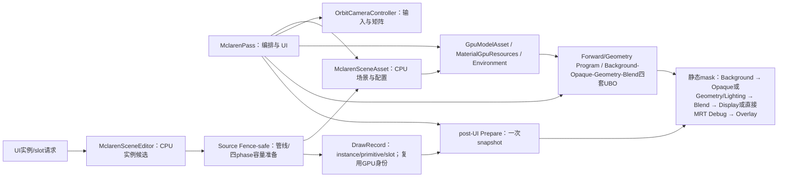
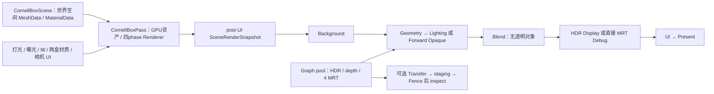

# 示例模块设计

核对日期：2026-10-21。保留原 Triangle 文档路径，现在统一说明七个示例的当前装配。

## 公共入口

七个 main 都创建 `EngineConfig`，再交给 `runApplication()` 统一解析参数、创建 Engine、注册 Pass、compile/run 和归纳退出码。Vulkan 帧循环、交换链、同步、深度和 UI Backend 由 Engine 持有。

| 示例 | Pass/组件 | 当前绘制 |
|---|---|---|
| [Triangle](../../examples/triangle/TrianglePass.cpp) | TrianglePass | Shader 生成 3 顶点，颜色经 fragment Push Constant 传入 |
| [Cube](../../examples/cube/CubePass.cpp) | CubePass | Shader 生成实心 36 顶点或线框 24 顶点；两套 Pipeline |
| [Alpha3Pass](../../examples/alpha3pass/AlphaPasses.cpp) | 三个 AlphaShapePass | 每个 3 顶点，显式依赖链，共享颜色附件 |
| [Mclaren](../../examples/mclaren/MclarenPass.cpp) | MclarenPass ScenePrepare/替换/相机及公共 ScenePasses | Background → Forward Opaque 或 Geometry/Lighting → Blend → Display |
| [ForwardReuse](../../examples/forward_reuse/ForwardReusePass.cpp) | ForwardReusePass ScenePrepare 与公共 ScenePasses | 两路径 semantic/HDR/normal fixtures，共享资产与稳定 snapshot |
| [CornellBox](../../examples/cornell_box/CornellBoxPass.cpp) | CornellBoxPass ScenePrepare、公共 ScenePasses、可选 CornellBoxReadback | 程序化房间/两盒/顶灯，默认 Deferred 10 draws / 114 vertices；Forward 9/111 |
| [GraphResourceProbe](../../examples/graph_resource_probe/GraphResourceProbePass.cpp) | GraphResourceProbePass | 六 Pass Graph：ImageClear、BufferFill、native Copy callback、normal Compute callback、SampleDraw、PostDrawCopy；固定 1 draw / 3 vertices |

普通运行（无readback probe）含唯一 Display：Mclaren Forward91/9,202,884、Deferred92/9,202,887；ForwardReuse Forward9/45、Deferred10/48。Deferred 多一个 Lighting 全屏三角形；测试 UNORM/SRGB display probes 额外2 draws/6 vertices，fixture/天空开关也改变计数，不把探针计数当普通基线。

七个示例共享以下非交互冒烟参数：`--smoke-frames N` 按成功提交的帧数停止（`0` 保持无限交互循环）；`--smoke-require-validation` 要求可捕获 Validation 消息；`--smoke-resize-after FRAME WIDTH HEIGHT` 在指定提交帧后请求窗口 resize，且帧上限至少比该帧多两帧；`--smoke-sidebar-collapsed` 从紧凑侧栏启动并核对布局；`--smoke-inject-validation-error` 仅用于受控负例，必须同时要求 Validation 与正帧数。普通不带参数的运行方式不变。

各Pass可选提供`expectedFrameStatistics()`；RenderPipeline仅在所有启用Pass都有预期值时汇总，Runner将最后一个completed submit业务计数精确比较并输出`KUENGINE_COMPLETED_STATS ... status=matched`；不匹配/无快照/缺预期均smoke fail。Triangle1/3、Cube默认1/36、三Alpha3/9。MclarenSource Prepare为0/0；Background按sky开关0/0或1/3，Surface按snapshot每实例有效draw的indexCount累加，Display或GBufferDisplay始终1/3，DeferredLighting另1/3，Blend按实际分流计数。多实例按全部实际draw构成精确match，不仅单模型subMesh常数或正数检查；顶部默认计数含唯一Display，fixture/Clear/probe另按构成核对。

## Triangle 与 Cube

TrianglePass 从当前运行目录 shaders 读取 SPIR-V，以 RenderContext 的颜色格式创建 Pipeline。不使用 Vertex Buffer 或深度；Draw Call=1，提交顶点=3。

Cube 的 MVP、颜色和模式通过 Push Constants 传给 Shader；左键仅在场景逻辑矩形内开始拖动，视口内滚轮缩放，UI 捕获、侧栏和失焦不改变相机。投影比例来自共享 `ViewerLayout`。UI 切换实心/线框、距离和颜色。当前也不启用 Runtime 深度。两种模式都是一次 draw。

## Alpha3Pass

Background → MainTriangle → Accent 通过 dependsOn 声明顺序，并共同写 SwapChainColor。首节点使用 RuntimeDefault Load，后续节点使用 LOAD，Store=STORE 保留颜色；每个节点有独立 Rendering Scope。各节点 UI 调整颜色、位置与缩放。

启用全部节点且 Pipeline 就绪时，业务 draw 数为 3、提交顶点为 9。该示例不创建离屏中间图像。

## Mclaren 与 ForwardReuse 组件关系

- SceneAsset读取场景、默认/fit/label并保存相机、光照、模型中心和fitScale；公共Forward按实例/handle构建GPU mesh、variant与draw。上传后`releaseCpuMesh()`释放capacity-zero顶点/索引/纹理及HDR像素，保留bounds、primitive/material与instance编辑元数据。`SceneData::valid()`仍要求完整CPU导入payload；释放后不是重新导入校验成功。fit是导入静态缓存，实例编辑不重新frame相机，SceneData没有聚合bounds字段。
- `OrbitCameraController` 仍是 Mclaren 的示例层控制器（历史文件名未改），提供 `ViewerCameraMode::OrbitInspect` / `FreeFly` 和供渲染统一消费的 `CameraFrame`；`CameraInputSample` 仅适配 `ViewerLayout`、Runtime Input 与 ImGui 捕获状态。比例取自共享 `ViewerLayout`，不再维护第二套局部视口。
- coordinator拥有Program、Background/Opaque/Geometry/Blend四套独立UBO和长期资产。Fence-safe update发布path pending/替换/相机输入，post-UI execute只构snapshot；静态mask互斥Opaque/Geometry，debug仍执行Geometry/Lighting/Blend，只直接MRT输出替换普通Display。ready recompile保留state，正常切换不重载/上传/compile图。
- ready 为 false、视口无宽度或数据更新失败时提前退出，统计只累加实际经过 CommandList 的绘制。

Mclaren main 设置 enableDepth=true；Engine 选择 Depth 格式；Depth Image allocation/resize 由 Graph pool 拥有。Model/HDR 的 Sidebar 和专用 CLI 请求在正常 Pass update 的单帧 Fence-safe 点处理：模型候选重建场景、fit、公共 GPU 资产、Pipeline/帧容量与预期统计，环境候选只重建 HDR/环境资源；成功才发布，失败保留当前画面、相机与统计。更多 GPU 绑定细节见 [PBR 设计](10-pbr-rendering.md)。

### Mclaren 查看器相机

OrbitInspect 保留既有语义：左键必须从场景区域开始拖动，改变模型 yaw/pitch；场景滚轮改变观察距离。FreeFly 以右键从场景区域开始获得输入焦点并转向，焦点存在时 `W/S/A/D` 前后左右、`Q/E` 下上移动；移动向量归一化、按 `deltaTime` 缩放，yaw 环绕、pitch 限制在接近 ±89°。右侧栏、文本输入、键盘/鼠标捕获、失焦、布局失效或 interaction epoch 改变都会取消焦点并要求输入先回到中性，防止跨恢复/切换的按键或鼠标残留。

模式切换使用当前 `CameraFrame` 双向交接：进入 FreeFly 从 Orbit 视图位置/朝向播种，返回 Orbit 从 FreeFly 位置/朝向重建目标；切换后先要求中性输入。`Reset View` 以场景配置恢复当前模式的视图，`Reset Model Rotation` 只清 Orbit 模型旋转。该控制器尚未是公共相机 API，Cube 也没有 FreeFly。

两例strict SceneConfig renderPath实际生效，CLI优先且兼容--deferred；Rendering UI支持路径/八debug views与资源/材质/灯光/相机/侧栏保留。ViewerPathSmoke有限例侧验证使用同UI CPU发布API、actual completedSubmit配对，late resize保留旧copy extent至统计推进，helper异常unmap；不是Runtime状态机或真实点击。Mclaren新增严格`--scene`、实例/slot编辑与独立ClearEnvironment（见07/05/10）。DrawRecord保存instanceIndex/mesh/subMeshIndex/materialIndex；CPU editor只复制实例候选，Source准备Forward/Geometry keys和全部phase容量后发布元数据/draw，不重传mesh/纹理/descriptor。选中项在path/resize/recompile保留，模型成功替换才重置。

MclarenEditSmoke是示例局部有界验证，29samples/16edits/layout，两layout；两实例各覆盖TRS/全部标量/Unlit→PBR恢复，采用真实request/Fence发布与actual completedSubmit。Clear50→Forward52→GBuffer54→resize/recompile56→LoadB58→badedit60。独立几何投影1px ROI/model/world-position参考与未放宽阈值、真实GUI证据见usage，非Runtime/ECS/M5 profiler。

## 当前约束与验证入口

旧 MclarenRenderResources 仍可能作为未构建遗留文件存在，不是当前主干。CameraController 可以独立做 CPU 测试，其他示例绘制仍需 GPU 冒烟验证。当前没有通用 Scene/ECS 或编辑器。

运行和回归操作见 [usage](../usage/README.md)，此处仅描述模块设计。

## CornellBox 程序化延迟 PBR

源码：[入口](../../examples/cornell_box/main.cpp)、[几何/材质](../../examples/cornell_box/CornellBoxScene.cpp)、[Source 接口](../../examples/cornell_box/CornellBoxPass.h)、[装配](../../examples/cornell_box/CornellBoxPass.cpp)、[读回](../../examples/cornell_box/CornellBoxReadback.cpp)。

`cornell::makeScene()` 生成世界空间 MeshData：房间 x/z∈[-1,1]、y∈[0,2]，+Z 开口，五面内向法线，红左/绿右/白地顶背墙。短盒中心(-.4,.325,.3)、尺寸(.58,.65,.58)、yaw -17°；高盒中心(.36,.6,-.3)、尺寸(.58,1.2,.58)、yaw +19°；盒面外向平法线。独立顶灯 y=1.985，避免与 y=2 天花板重合。共 8 submeshes、72 顶点、108 indices，材质全部 PBR/Opaque，默认 metallic=0，短/高盒 roughness=.36/.72。几何、材质及 1×1 中性环境都由代码建立，不经过 SceneLoader、JSON、ModelLoader 或外部 HDR。

顶灯固定 emissive=(12,10.8,9)，四个暖色点光提供直接照明，中性环境默认 fill=.25。Ceiling light 只缩放四点光，不关闭灯面 emissive。沿用公共简化 Metallic-Roughness PBR，无阴影、GI、真实面积积分或完整 IBL，不是路径追踪参考结果。

`CornellBoxPass` 同时实现 RenderPass/SceneDrawSource，持有 CPU MeshData、GpuModelAsset、PBRMaterialResources、PBREnvironmentResources、Forward/Geometry Program 及 Background/Opaque/Geometry/Blend 四套独立 Renderer UBO。`sceneSnapshot()` 提供稳定 view/draws，`sceneRenderer(phase)` 借用对应 renderer；Fence-safe update 发布 path mask，post-UI execute 一次构建 8 draws snapshot。ready initialize/recompile 保留资源及 UI 参数；析构依次释放 renderer、材质/环境/model、program。Pipeline 拥有公共 Pass，Graph pool 拥有 HDR、depth 与四 RGBA16F MRT。

默认 1280×960、Deferred；`--render-path forward` 与公共 `--deferred`/smoke 参数可用。默认 skybox 关闭，Background 为 0/0；Geometry 8/108 + Lighting 1/3 + Display 1/3 = 10/114；Forward 为 Opaque 8/108 + Display 1/3 = 9/111；Prepare/Blend/读回均为 0/0。顶点统计是提交索引数，并非 72 个去重顶点。侧栏相机只提供 yaw/pitch/distance/Reset view，不接入鼠标 Orbit 或 FreeFly。

可选 `--cornell-readback-prefix` 仅用于普通 Deferred 的有限帧验证。CornellBoxReadback 声明 BaseMetallic/PositionModel/HDR 三图 TransferSource、导入自有 staging 为 TransferDestination，依赖 ForwardDisplay，在 Rendering Scope 外复制；Graph 负责传输与 HOST_READ 边界，单帧 Fence 后的 update/onResize inspect 才 invalidate/map。容量为 2048² 像素×三张 RGBA16F；rawbin 为 width/height 两个 uint32 后接三平面 half，PPM 是场景 viewport HDR 经 CPU 曝光/Reinhard/sRGB 转换的预览，非 Swapchain 截图。它不支持将任意材质交互、Forward/debug 路径视为通用截图。

2026-10-21 [独立 QA](../../build/qa-cornell-box/qa-report.md) ACCEPTED：两配置 core142，Debug 定向 CTest7/7（0skip），显式 SyncVal errors=0，Release 默认/resize-recompile/Forward 真实 GPU 退出0；独立 half 原始像素和 ray/plane/OBB 检查、真实 GUI 控件通过。未运行项及命令见 [使用说明](../usage/cornell-box-example.md) 和 [回归说明](../usage/regression-checks.md)。
