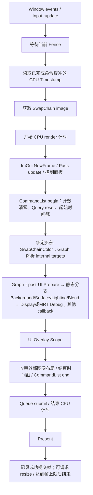

# Core 与公共 Runtime 设计

核对日期：2026-10-11（C只读验收，A既有completed-statistics getter；同步/调度未重写）。

源码：[Engine.h](../../src/KuEngine/Core/Engine.h)、[Engine.cpp](../../src/KuEngine/Core/Engine.cpp)、[ApplicationRunner](../../src/KuEngine/Core/ApplicationRunner.h)、[Window](../../src/KuEngine/Core/Window.h)、[Input](../../src/KuEngine/Core/Input.h)。

## 职责与配置

Engine 聚合窗口、Vulkan 对象、渲染管线和 UI，负责创建、运行、交换链重建与销毁。所有示例均通过 `Engine::addPass<T>()`、`compile()`、`run()` 接入。

| EngineConfig 字段 | 当前含义 |
|---|---|
| title / width / height | 窗口配置；默认 1280 × 720 |
| framesInFlight | 默认且只允许 1 |
| showStats | 控制统计面板显示 |
| enableDepth | 是否为需要深度的 Graph Pass 选择 depth format，默认 false；不创建 RuntimeDepth |
| depthFormat | 启用深度时，UNDEFINED 表示自动选择支持的格式 |
| clearColor / clearDepthStencil | 附件清除值 |
| depthCompareOp | 默认 LESS，传入 RenderContext |

是否启用深度由 enableDepth 决定，不能仅通过 depthFormat 是否为 UNDEFINED 判断。

`EngineRunOptions` 不属于持久渲染配置：`submittedFrameLimit=0` 保持无限交互循环；正值按成功提交的帧数停止。可选 `EngineResizeRequest` 在指定成功提交帧后调用窗口 resize，并由 `EngineRunResult` 分别记录请求与 Swapchain 重建完成。未 acquire、仅处理 resize 的循环不计入 submitted frame。该接口让自动化运行不依赖计时或强制关闭窗口，普通调用 `run()` 的行为不变。

六个示例通过`ApplicationRunner`解析`--smoke-*`参数。它在Engine作用域外保存ValidationMessageTracker，Engine等待GPU、销毁RHI/Instance后仍可读取已捕获error决定退出码：参数错误2、普通初始化/运行失败1、Validation失败3、已知环境不可用smoke skip77。Mclaren的scene/实例编辑/Clear parser与候选队列留在示例，B不新增Runtime场景/ECS/验证状态机。

## 一帧时序

FrameData 携带 frameIndex、imageIndex、deltaTime、totalTime 和本帧 `ViewerLayout`。Engine 在 acquire 成功后、Pass update 前从逻辑窗口尺寸、framebuffer extent 与 Sidebar 快照计算它；Mclaren 只在示例层将这份 FrameData/Input/ImGui 状态适配为 `CameraInputSample`，Runtime 不拥有相机模式或场景相机。frameIndex 是同步槽索引，单帧配置下一直为 0；imageIndex 才是获取到的交换链图像索引。

## 深度、布局与 resize

既有const `completedFrameStatistics()`返回`const optional<CompletedFrameStatistics>&`，无测试状态机/新调度器。helper使用actual completedSubmit而非frameIndex/FIF/Graph frameSerial；resize waitIdle可能早于统计推进，等待getter推进并保留旧copy extent，异常unmap仅helper修复。Source既有Fence-safe update发布mask。C只读验收未改Runtime；真实输入独立观察/用户自测/重复豁免与专项NOT RUN见[回归](../usage/regression-checks.md)。

Engine 不再 allocation/bind RuntimeDepth；对需要 Forward depth 的示例，`enableDepth` 只触发 depth format 选择，Graph-owned ForwardSceneDepth 由 Pipeline pool 创建。clear value 通过 RenderContext 传给 Graph target；旧 Runtime depth Load/Store 配置已移除。

Engine 记录每个交换链图像的布局，并按 typed handle 绑定实际 Image、View、Extent、Aspect、usage、Layout、Load/Store、Clear 和最终布局。Pipeline 验证外部 descriptor 与 expected usage 的完整超集；Graph internal allocation 是 Pipeline-owned pool 的职责，Engine 不拥有它。Present 前颜色图像转换到 PRESENT_SRC_KHR。

尺寸变化或交换链过期时Engine等待device idle、重建Swapchain、清外部绑定并通知onResize，pool重建relative targets。自动resize由GLFW请求，观察新Swapchain generation才resizeCompleted。最小化暂缓绘制并短休眠，Input epoch切断连续性。最终C有普通true minimize/restore与真实resize证据，专项epoch-held stress未新实机执行；Win+D/物理非等比DPI尚未覆盖。

退出时先等待 GPU，再销毁 Pass、UI 和图像/命令/同步/交换链及命令池，之后依次销毁 Device、Surface、Instance 和 Window，保证依赖对象仍存活。

## Window 与 Input

Window 封装 GLFW 初始化、窗口、事件、framebuffer resize 与关闭回调；通过窗口计数控制 GLFW 初始化/终止。Input 保存全局静态按键/鼠标状态，支持 down、pressed、逻辑鼠标位置/位移、滚轮、活动状态和 interaction epoch。`ViewerLayout` 将逻辑输入矩形映射为 framebuffer 视口；当展开侧栏会保留右侧场景宽度，紧凑/重开模式覆盖场景；逻辑与像素比例独立计算，并在尺寸无效或过小时回退为可渲染的完整场景/至少一像素矩形。

## 计时与约束

CPU 使用 Engine::Clock（`steady_clock`）测量 acquire 成功后至 submit 返回的墙钟时间，包括 Pass 更新、UI 和命令记录；不包括事件轮询、Fence/acquire 等待与 present。submit 后暂存 CPU 与业务计数，下一次 Fence 完成或退出 `waitIdle` 后与 GPU Query 合成 completed-submit 快照；FPS/Frame 仍是当前主循环的 `deltaTime`。详细显示语义见 [UI 与统计](05-ui-layer.md)。

Runtime 的单帧限制是命令、动态 UBO、深度和 QueryPool 复用的前提。当前没有独立场景管理器、固定时间步模拟或多窗口运行调度。
