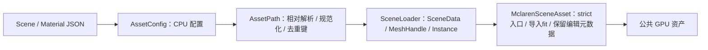

# 资源目录与资产配置设计

核对日期：2026-10-10（B严格scene入口与轻量编辑元数据）。

源码：[AssetPath](../../src/KuEngine/Asset/AssetPath.h)、[Scene](../../src/KuEngine/Asset/Scene.h)、[HDRImage](../../src/KuEngine/Asset/HDRImage.h)、[AssetConfig](../../src/KuEngine/Asset/AssetConfig.h)、[MclarenSceneAsset](../../examples/mclaren/MclarenSceneAsset.cpp)。

## 已有资源布局

| 实际路径 | 用途 |
|---|---|
| resources/models/props/mclaren_765lt.glb | 示例模型 |
| resources/scenes/sandbox/mclaren-sandbox.scene.json | 场景入口 |
| resources/materials/pbr/mclaren-765lt.material.json | 全局材质覆盖 |
| resources/environments/hdr/citrus_orchard_road_puresky_4k.hdr | 示例环境 |
| resources/manifests/asset-registry.json | 资产登记信息 |
| resources/shaders/common/lighting.glsl | 公共 GLSL 光照片段 |
| examples/*/shaders | 各示例 Shader |

部分目录保留分类占位，但目录存在不等于运行时支持相应格式。当前模型仍直接放在 props 下，没有强制实现旧文档提出的“每个模型一个 runtime/meta 包”结构。

CMake 将示例所需资源复制到可执行程序旁 resources。实际加载先查运行目录，再按 KUENGINE_SOURCE_DIR 回退源码目录。资产清单虽被复制，目前没有统一 Registry 加载器/缓存，也不通过清单自动发现模型。

## SceneConfig

| 结构 | 当前解析字段 |
|---|---|
| SceneCameraConfig | position、target、up、fovYDeg、near、far |
| SceneLightingConfig | direction、color、intensity |
| SceneNodeConfig | id、model、material、TRS、可选 materialOverride |
| SceneConfig | renderPath默认Forward、camera、lighting、nodes、可选environment |

loadSceneConfigFromFile 返回 bool，可传 errorMessage；缺字段使用结构默认值。`environment` 是向后兼容的可选字段。findResourcesRoot 为模型、材质和环境相对路径解析定位 resources 根。

`SceneLoader`构建公共SceneData：MeshAsset以稳定MeshHandle保存唯一模型，SceneInstance引用handle并保存material reference、override、TRS与scalar-only `SceneMaterialSlot`列表。slot含slot索引、PBR/Unlit、base RGBA、emissive RGB、metallic/roughness，不含ImGui/GPU/纹理对象。AssetPath规范路径键去重，完整模型与handle图校验后才发布。TRS为`T * Rz * Ry * Rx * S`，有限且各scale>1e-5；Mclaren导入时合并变换后的AABB缓存fit/label，主路径按实例记录共享GPU mesh，不再合并mesh。编辑用保留元数据，不重算导入fit；SceneData没有聚合bounds字段。

## MaterialConfig

独立`asset::RenderPath`不是材质ShadingModel。Scene JSON `renderPath`可省略（Forward），存在时必须string且精确小写`forward`或`deferred`；非法类型/值失败。公共parser剥离`--render-path forward|deferred`/`--deferred`，CLI覆盖配置；不同选择冲突、非法/缺值报错，相同重复选择允许。Mclaren parser另剥离`--scene <path>`传实际SceneAsset入口，缺值/重复返回参数错误2；显式scene不存在/非法JSON/空model/错误model、material、HDR引用返回初始化失败1，不退回默认车/HDR。根优先祖先`resources`，没有时为显式scene父目录；引用相对该根解析。显式无environment创建有效1×1 RGBA32F黑fallback。无参数旧默认scene缺失才兼容回退，已存在但无效scene失败；非显式material旧回退仍保留。路径仅选择静态Pass分支，UI发布见 [Deferred控制](13-deferred-rendering.md)。

当前解析 id/version/pipeline、alphaMode、doubleSided、alphaCutoff、baseColorFactor、metallicFactor、roughnessFactor、normalScale、occlusionStrength。

textureBindings 包含 baseColor、normal、metallicRoughness、occlusion、emissive 和 legacy orm；各绑定有 source、colorSpace、channelMapping、uvSet 和相应 has* 标记，用于区分“未指定”和“显式覆盖”。配置经公共 Forward 材质解析转换为实际 binding。

各语义均可有 source/colorSpace/channelMapping/UV binding：base、normal、metallicRoughness、occlusion、emissive；legacy `ormBinding` 仅在显式 MR/AO 都不存在时映射到两者。source 当前用于选择 glTF 内置纹理或禁用；不提供任意外部纹理路径加载。channelMapping 是 descriptor-variant 键的一部分，但不代表任意通道重打包。

## 解析与 GPU 的边界

AssetConfig/AssetPath/SceneLoader/HDRImage不创建Vulkan对象。`SceneData::valid()`仍严格要求完整vertices/indices与drawable ranges，释放payload后不以valid()代表编辑元数据可用。MclarenSceneEditor是示例CPU queue/candidate，Source负责GPU准备与安全发布（见04/11）。初始SceneData.environment是导入元数据，不代表后续替换/Clear的active HDR；后者由Source已发布环境state/controller拥有。ForwardReuse配置失败即失败。

Mclaren 替换入口接受相对于已解析 resources root 的路径或绝对路径；模型仅接受 `.gltf`/`.glb`，环境仅接受 `.hdr`，且必须存在并是普通文件。UI/CLI 只排队请求；路径、解码或兼容性失败会保留当前已发布资产，不产生半成品状态。当前没有文件选择器、文件监听器、异步加载或跨场景缓存。

## 当前约束

资源命名和元数据依赖人工维护，没有自动 schema 校验、压缩纹理导入、异步加载、资产 Registry 或缓存。Mesh 路径在单次 SceneData 加载内去重，但没有跨场景缓存。Mclaren 的同步替换已实现；更完整通用导入入口尚未实现。
