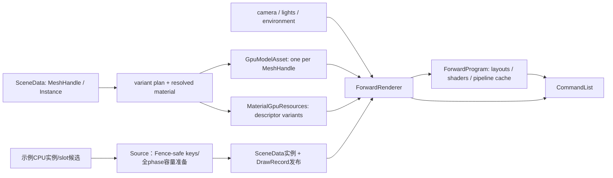

# 公共 Forward 渲染

核对日期：2026-10-10。本文只描述已实现的公共 Forward 路径。源码：[ForwardGraphTargets](../../src/KuEngine/Render/ForwardGraphTargets.h)、[ForwardDisplayPass](../../src/KuEngine/Render/ForwardDisplayPass.h)、[ForwardProgram](../../src/KuEngine/Render/ForwardProgram.h)、[ForwardRenderer](../../src/KuEngine/Render/ForwardRenderer.h)。

## 边界与所有权

`ForwardProgram` 独占固定 descriptor layout、公共 Forward shader 和有限的 `ForwardPipelineKey` 管线缓存；key 仅由 `ShadingModel`、`AlphaMode` 与 `doubleSided` 构成。`ForwardRenderer` 独占帧 UBO、按 draw 对齐的动态 UBO、frame/draw descriptor pool 与 set，并负责容量检查/扩展。`render()` 只在调用期间借用 `ForwardView`、`ForwardDraw`、`GpuModelAsset`、`MaterialGpuResources` 与环境资源；调用方必须让被借用的 GPU 资产活到 renderer 释放 descriptor pool 之后。

M3-WP03 将其 RHIShader 调用迁移为显式 path/stage/entry 的唯一 vertex/fragment 描述；M3-WP04 进一步将输出接入 Graph-owned SceneColor/Depth，Renderer 只拥有 frame/draw UBO 与 descriptor，不拥有借用的 GPU 资产或 targets。M4-WP01 新增 Program geometry mode，以相同 set schema/Renderer 写四 MRT；见 [Deferred](13-deferred-rendering.md)。

公共 layout 固定如下，不能由业务 Pass 临时改变：set 0 为五个材质 sampler（base、normal、metallic-roughness、occlusion、emissive）；set 1 为 frame UBO；set 2 为 lat-long 环境 sampler；set 3 为动态 draw UBO。材质/环境资源在创建时借用 Program 的 layout；销毁顺序为 renderer、资产资源、program。

## 场景、材质和 draw

Scene 实例以稳定 `MeshHandle` 指向唯一 mesh；实例持有 TRS、可选 material reference 和显式 override。TRS 使用列向量 `T * Rz * Ry * Rx * S`，要求有限值和正 scale；fit 使用变换后的 AABB。`ResolvedMaterial` 合并 glTF 材质与实例 override，包含 PBR/Unlit、Opaque/Mask/Blend、cutoff、double-sided、五类 texture transform、scalar 和 UV 信息。`KHR_materials_unlit` 被映射为 Unlit。

GPU 材质 variant 只按会改变 descriptor 的 mesh、纹理 source、color space、channel mapping 去重，并按规范排序，使 index 与实例顺序无关；draw 保存稳定 variant index。scalar 和 UV-only override 仍进入 per-draw UBO，不拆 variant。legacy combined ORM 只在显式 MR/AO 都不存在时映射到两者，因此 UV-only override 不会破坏 embedded/legacy ORM。

公共`SceneMaterialSlot`仅有slot/shadingModel/base/emissive/metallic/roughness标量，无ImGui/纹理/GPU所有权。`resolveInstanceMaterial(base,instance,slot)`先合并glTF与实例override，再应用匹配slot标量；同实例同slot的所有primitive联动。Mclaren DrawRecord保留instanceIndex、mesh、subMeshIndex、materialIndex(slot)、variantIndex，支持候选重算。CPU editor校验有限TRS/正scale、范围及变换bounds/normal matrix；Source调用`ensurePipelines`和四phase `ensureCapacity`全部成功后才交换实例/draw并增长generation，失败不发布。scalar/TRS不调用资产上传、descriptor重建；准备可能扩展renderer UBO/管线，不等于重传共享Mesh/Texture。

每个 draw 写 model/normal matrix、factor、texture transform、flags 到动态 UBO；emissiveFactor.w 为 GBuffer code。Frame UBO 由公共 makeForwardFrameUniforms 打包，供 Forward 与 Deferred Lighting 复用。动态 offset 采用设备要求对齐，容量溢出或无效 draw 会返回错误而不是越界。一个 mesh 可由多实例共享 GPU 上传；不同纹理 override 必须建立独立 variant。

## 着色、顺序与生命周期

PBR 计算方向光、最多四个点光与基础 lat-long 环境贡献；Unlit 只输出材质颜色/emissive，不读取直接或环境光照。Skybox 使用同一环境输入，天空可见与环境照明贡献独立。两路径共享 swapchain-relative `ForwardSceneColor`（RGBA16F，COLOR_ATTACHMENT | SAMPLED | TRANSFER_SRC）和 `ForwardSceneDepth`（DEPTH_STENCIL_ATTACHMENT | TRANSFER_SRC），图像均由 Graph pool 拥有。Background CLEAR/STORE → Forward Opaque/Mask 或 Geometry/Lighting → Forward Blend → Display → RuntimeOverlay → Present。Geometry/Forward Opaque 的深度 CLEAR/STORE，Blend 颜色/深度 LOAD/STORE，depth test/no write；Lighting LOAD SceneColor，Empty discard 保留背景。

`SceneDrawSource`由示例ScenePrepare coordinator实现，`execute`在UI后一次生成`SceneRenderSnapshot{view,draws,preparedTime}`，借用已发布资产一提交。Background/Surface/Lighting/Display/GBufferDisplay显式依赖Prepare，checked snapshot拒绝disabled/stale。当前Background/Opaque/Geometry/Blend各自独立Renderer/frame-draw UBO/descriptor，Lighting另有frame UBO；不是Opaque与Geometry共用offset0。资产共享不重复上传。Source还拥有非拥有CPU ScenePathControl，UI request下一Fence-safe update发布静态enabled-mask，正常切换不重载/compile图。源码见 [ScenePasses](../../src/KuEngine/Render/ScenePasses.h) 与 [Deferred/debug控制](13-deferred-rendering.md)。

Prepare只构建snapshot，各Renderer在对应phase执行时准备/写入各自UBO。`ForwardDisplayPass(ViewProvider,prepareDependency)`借用snapshot参数；`ForwardDisplayProgram::draw(...,exposure=1,encodeSrgb=true)`完成唯一显示，旧bool deferredSource构造保留兼容、读取共享Color别名。资源表/graph流程见 [Deferred](13-deferred-rendering.md)。

不透明和 Mask 先绘制；Blend 按对象中心相对相机的距离从后到前排序，距离相同按原始顺序稳定。Mask 执行 alpha discard 并写深度；Blend 使用 alpha blend、不开深度写；`doubleSided` 选择禁用 cull 的管线变体。排序是对象级，不解决相交透明几何。

Mclaren 及 ForwardReuse 都在现有单帧 Fence-safe Runtime 中拥有 Program/Renderer。Mclaren 在模型替换成功时重建其 mesh/variant/draw、确保管线和 renderer 容量；环境替换只重建环境资源并 rebind。失败保留已发布 state。多帧 retire、异步加载和跨场景缓存尚未实现。

Forward/PBR/Unlit/Sky/Deferred Lighting 只输出线性颜色；Display 是唯一曝光、Reinhard（`c*exposure/(1+c*exposure)`）和显示转换阶段。Display 使用 `sceneFramebuffer` 的 UV scale/offset nearest 采样，UI 在转换后合成。UNORM 在 outputGamma 开启时手动 linear→sRGB；SRGB attachment 始终由硬件编码，不重复编码，其 UI gamma 开关禁用，不能通过该开关关闭硬件编码。曝光不改变显示前 SceneColor。

首次 initialize 加载资产并创建 renderer；ready 后重复 compile 不重新加载、重置模型/材质/相机/UI/替换状态。Display/Lighting 按格式完整构建 candidate 后发布；内部 pool 在 resize 重建 relative targets，descriptor 按 generation/ImageView 重绑。重建依赖 Fence-safe/显式 idle，单帧资产候选成功才发布；没有多帧 retire。实际离屏 UNORM/SRGB 已验证，未强制真实 live-format change。

## 接入示例

`ForwardReuseApp` 是最小公共使用者。它从 data-URI glTF semantic card 建立一个 mesh（4 primitives）和两个实例，产生两个 GPU descriptor variants、Forward+Display 精确 9 draws / 45 submitted vertices。它覆盖 PBR/Unlit、MR/AO/emissive UV、Opaque/Mask/Blend、double-sided、零光与背面视图预设；环境是内建 1×1 输入，不依赖外部 HDR。操作见 [ForwardReuse 使用说明](../usage/forward-reuse-example.md)。

Mclaren 现在也完全经公共 Forward 提交；旧 `MclarenRenderResources` 与旧 shader 文件可能仍在树中，但不再构建或运行，不能视作当前主路径。
