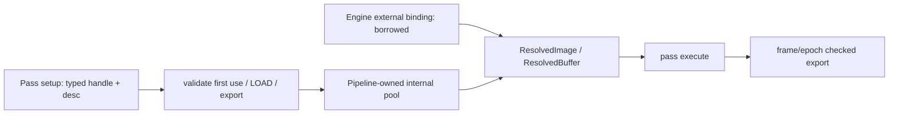

# Graph 资源与生命周期

核对日期：2026-10-11。本文描述已实现的图资源、同步、受约束执行、共享线性HDR与直接MRT调试输出。最终C QA已接受首轮范围，C只读审计无新Runtime接口；接入操作见[开发渲染特性](../usage/developing-render-features.md)。源码：[RenderGraph](../../src/KuEngine/Render/RenderGraph.h)、[资源池](../../src/KuEngine/Render/RenderGraphResourcePool.h)、[Pipeline](../../src/KuEngine/Render/RenderPipeline.h)、[Probe](../../examples/graph_resource_probe/GraphResourceProbePass.cpp)。

## 声明与类型安全

`RenderGraphBuilder` 以 `createImage`/`createBuffer` 声明内部资源，以 `importImage`/`importBuffer` 声明借用外部资源；返回的 `ImageHandle` 或 `BufferHandle` 带 index 与全局 graph generation。转为 `ResourceHandle` 时保留 kind。每次 Graph reset/新建都会取得新的 generation；过期、越界或 image/buffer kind 不匹配的 handle 会被拒绝。

同名资源必须拥有完全相同的 kind、ownership 与 descriptor，否者编译失败。`ImageDesc` 指定 absolute 或 swapchain-relative extent、format、usage、aspect、clear value、initial content；`BufferDesc` 指定 size、usage、VMA memory usage 与 initial content。当前 allocation 仍只支持 2D、mip 1、layer 1、sample 1 image，没有 3D、MSAA 或 aliasing；但 use/resolve 已接受并规范化 `ImageSubresourceRange` 与 `BufferRange`，检查请求范围包含于描述和已声明 use，planner 可对 range split/merge。

`Undefined` 资源不得首读；内部 `Cleared` image 的首次使用必须是 CLEAR attachment，internal buffer 不支持隐式 clear；LOAD 需要已定义内容。export 必须显式声明，且编译时要求最终存在可存储的已定义内容。同一 Pass 可通过显式 `ComputeStorageReadWrite` 等 read-write use 声明算法性读写；不接受隐式的、未声明 use/range 的同资源混用，attachment 与 native/callback 操作仍须符合各自的 scope/contract。

## 所有权、解析与失效

`RenderPipeline`独占Graph/pool/export lifetime state。pool只分配/销毁internal；import调用方拥有并保持到提交完成、负责图外同步，Pipeline仅借用。bind可按typed handle或name，核kind/name、尺寸/format/aspect（image）、size（buffer）及usage完整超集。BindingInfo准确传initialState/finalState/contentsValid；image另传clearValue/defaultLoadOp/defaultStoreOp，layout位于ResourceState2内，不隐式完成图外工作。

执行时 Pass 从 resolver 获取 `ResolvedImage`/`ResolvedBuffer`，包含 Vulkan handle、descriptor-derived metadata、allocation generation、content-valid 和 external 标记。allocation 可跨帧缓存，但 `beginFrame` 使 internal transient content 无效，因此不能将上一帧内容隐式带入下一帧。

compile 和 resize 均先创建 candidate graph/pool；资源分配或 pass resize 失败不发布 candidate。resize 对 swapchain-relative image 重建，对 absolute image 转移既有 allocation；绑定被清除。Probe 可见 relative image allocation generation 从 1 到 2，而 absolute buffer 保持 1，extent 640×480 到 800×600。

setup显式声明export后，`exportImage/exportBuffer`只在成功execute后返回，带owner weak reference/epoch/frame serial。recompile/resize、下一帧或Pipeline销毁即失效，须检查valid(&error)；完整stored/content-valid view才有效。token只借用，不转移所有权/延长GPU寿命；allocationGeneration用于descriptor重绑，不是跨帧retire。

## 执行边界与 Probe

`GraphResourceProbeApp` 顺序执行 ImageClear、BufferFill、native Copy callback、normal Compute callback、Graphics SampleDraw 与 PostDrawCopy：覆盖 internal image/buffer resolve、内容传递、transfer/compute/graphics use、attachment→sample、resize，以及 1 draw/3 vertices 统计。运行方式见 [Probe 使用说明](../usage/graph-resource-probe-example.md)。

## 用途、状态与同步

每个 Pass 用显式 `ImageUse` / `BufferUse` 声明访问；语义映射到 stage、access、layout 和 image/buffer range。`RenderGraphStatePlanner` 是纯 CPU 预规划器：在 disabled mask 之后检查 producer/consumer，追踪 RAW/WAR/WAW、读者集合和 writer epoch，并对 image range、buffer range 进行 split/merge；每个 stage 使用实际 access 覆盖，避免将多个读者错误地作 Cartesian 组合。该计划产生 synchronization2 image/buffer barrier 批次，由 Pipeline 用 `vkCmdPipelineBarrier2` 记录。

资源池继续保存 allocation，Pipeline 将 execution resource state/content 分离为提交 shadow；只有成功录制的 pass 才将 state/content 提交回 shadow。checked resolver 要求调用方按已声明 use 及 range 解析资源；Overlay 只声明交换链 color read/write；acquire 等待以 `ALL_COMMANDS` 作保守 stage mask。

Probe完整路径ImageClear+固定3vec2/index/indirect Fill→128B native Copy→32uint Compute Copy→sampled蓝三角indexedIndirect→128B PostDrawCopy，共六Pass/六resource/六dependency/五barrier。C实际蓝三角/resize/recompile/1draw3提交索引有正常exit0/SyncVal0证据；没有host whole-buffer数值读回，不是复杂生成几何/多队列/长时验证。

M3-WP03 补上 Compute、受约束 native API 与 resolver range 检查；M3-WP04 已将 Graph-owned Forward SceneColor、Depth/display 交接落地。

## Compute 与受约束回调

M3-WP03 提供显式 `ShaderDesc(path, stage, entry)`；graphics pipeline 只接受唯一 vertex/fragment stage。`RHIComputePipeline` 是独立 RAII pipeline，`RHIParameterSet` 检查 UniformBuffer、StorageBuffer、CombinedSampler、StorageImage binding 并在创建/写入失败时回滚。设备选择优先具备 compute 的 graphics queue，不把它提升为全局硬要求。

`CallbackRenderPass`由Pipeline拥有，header为RenderGraphCallbackPass.h；declare/prepare接受可变Parameters&，execute才接受const Parameters&，name/declare/execute必需，prepare/nativeContract/expectedStatistics可选。recompile刷新handle，稳定借用RHIDevice。GraphCommandContext只允许已声明handle/use/range的resolve/fill/copy/compute binding/dispatch。native scope move-only，已知capability/side-effect请求子集、checked use，attachment禁止Compute/Transfer；context析构active=false、ensureActive拒绝后续访问。after-execute lifetime为源码核对，无专项已执行永久误用测试，不宣称任意裸Vulkan自动正确。旧对象仍TrustedLegacyObject。

Probe Compute prepare检查graphics queue compute能力，用明确COMPUTE stage/storage layout，先reset旧pipeline/parameters/shader再build，不是transactional live-recompile恢复。Draw initialize完整candidate后发布。local32/group1只复制32uint，resize relative image generation递增、absolute buffer generation保持，统计1draw/3提交索引。M3-WP04已在Forward完成SceneColor/Depth/display交接。

## Forward 图目标与显示

`ForwardGraphTargets` 使用固定 RGBA16F SceneColor 与 Runtime depth format/clear value，声明 swapchain-relative internal `ForwardSceneColor`（COLOR_ATTACHMENT | SAMPLED | TRANSFER_SRC）和 `ForwardSceneDepth`（DEPTH_STENCIL_ATTACHMENT | TRANSFER_SRC）。Background CLEAR/STORE，Opaque/Mask 深度 CLEAR/STORE，Blend 颜色/深度 LOAD/STORE、test/no write；`ForwardDisplayPass` FragmentSampled 读取线性 SceneColor，执行唯一曝光/Reinhard/format-aware sRGB，CLEAR/STORE 写外部 SwapChainColor，RuntimeOverlay LOAD/read-write 后交给 Present。pool 负责 allocation/resize，Renderer 不拥有 targets。

Display 对 `sceneFramebuffer` 生成 UV scale/offset 并 nearest 采样。relative target resize 改变 allocation generation，Display 在 generation/ImageView 变化时重绑。format 变化重新 compile 相关 Pass/重建 UI，SidebarState 保留；Display/Lighting 构建完整 candidate 后发布，ready ScenePrepare 不重复加载资产。`--smoke-recompile-after-setup` 在 deviceWaitIdle 后第二次 compile。全部场景消费者显式依赖 post-UI Prepare，snapshot 借用资产一提交，独立 phase UBO 避免同帧覆盖。真实离屏 UNORM/SRGB 已验证，强制 live format-change 未运行。

## Deferred MRT 接入

WP03-A ScenePathControl只借用静态分支Pass，CPU request下一Fence-safe update一次发布mask，不重新compile/上传资产；复用Graph disabled-mask内容/屏障预检。Deferred debug启用Geometry/Lighting/共享Blend但禁普通Display，GBufferDisplay直接声明四MRT FragmentSampled→输出CLEAR/STORE，正常SwapChain借用、fixed-format probe内部输出Graph pool拥有；自有参数/pipeline/sampler按generation/view重绑，UI后合成。Forward普通branch不采样陈旧MRT；静态四phase UBO与资产均仍Source所有权。

ViewerPathSmoke/Readback为examples/common有限验证，不改Graph API/Runtime调度；bounded transfer→HOST_READ配对actual completedSubmit，late resize保留copy extent到统计推进，exception unmap只helper修复。config-isolated aggregate evidence不代表所有legacy prefix隔离；完整映射/状态与未运行边界见 [回归说明](../usage/regression-checks.md)。

Geometry CLEAR/STORE 写四 RGBA16F MRT 与共享深度；Lighting 四 FragmentSampled 读并 LOAD/STORE 写共享 ForwardSceneColor，Empty discard 保留 Background。Blend 使用 Geometry 保留下来的深度，Display 两路径读取同一 SceneColor；兼容 deferredSource 名称为共享资源名别名。Graph 自动生成 attachment→sample 与写后 LOAD 的同步2屏障；Lighting/GBuffer消费者保持启用而Geometry禁用会被内容预检拒绝，运行中消费者读disabled/stale Prepare会被checked snapshot拒绝。Lighting 按 generation/ImageView 重绑。示例 Readback 在 scope 外声明 TransferSrc/imported TransferDst→HOST_READ；Fence 后 invalidate/读取。HDR RGBA16F、UNORM/SRGB、visibility 与 pre/post Blend D32 深度使用有界 staging，最多2048×2048，不扩展公共 Graph API。布局/所有权见 [Deferred](13-deferred-rendering.md)。
