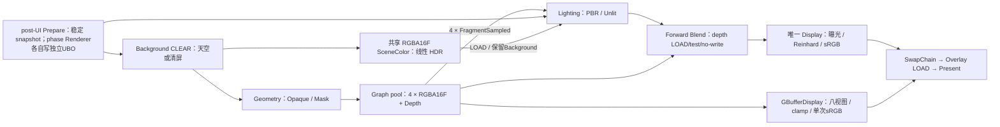

# 公共 Deferred 渲染

核对日期：2026-10-11。最终C QA ACCEPTED + DOCUMENTED、REQ-01～13首轮已验收，最终WP03/M4已由Lead审计闭环（DONE）。C无代码修改，Mclaren实例slot/strict scene/Clear延续既有实现。源码：[DeferredCommon](../../src/KuEngine/Render/DeferredCommon.h)、[Geometry](../../src/KuEngine/Render/DeferredGeometryPass.h)、[Lighting](../../src/KuEngine/Render/DeferredLightingPass.cpp)、[ScenePasses](../../src/KuEngine/Render/ScenePasses.h)、[GBufferDisplay](../../src/KuEngine/Render/GBufferDisplayPass.h)、[ScenePathControl](../../src/KuEngine/Render/ScenePathControl.h)。

## 契约与所有权

`DeferredCommon` 提供 `GBufferTargets`、`makeGBufferTargets`、`encodeGBufferShadingModel`、`supportsDeferredGeometry`、设备格式/附件能力检查及共享 HDR SceneColor descriptor。四个颜色附件均为 `R16G16B16A16_SFLOAT`，合计 32 B/pixel（不含深度），swapchain-relative、单采样，usage 为 COLOR_ATTACHMENT | SAMPLED | TRANSFER_SRC。位置直接存世界坐标，不从深度重建；半精度位置不适合无约束大世界。

| location / Lighting binding | 名称 | RGB | A |
|---|---|---|---|
| 0 | GBufferBaseMetallic | 线性 base color | metallic |
| 1 | GBufferNormalRoughness | 世界空间 normal | roughness |
| 2 | GBufferPositionModel | 世界空间 position | Empty=0、PBR=1、Unlit=2 |
| 3 | GBufferEmissiveAo | 线性 emissive | AO |

颜色附件 CLEAR 为全零、STORE；Depth 使用 Runtime 选定 format/clear value，名称沿用 `ForwardSceneDepth`，CLEAR/STORE，供后续 Blend LOAD/test/no-write。Empty 编码表示未绘制像素；未知 ShadingModel 不编码。Opaque/Mask 支持 PBR/Unlit 和双面分派；geometry API 拒绝 Blend/未知模型，SceneSurface 将 Blend 分流到公共 Forward 阶段，不隐式当作 Opaque 或排除最终合成。

`DeferredGeometryPass` 是抽象 Graph MRT/depth 适配器：initialize 检查能力，setup 声明附件，具体 draw 由调用方实现 execute。调用方拥有长期 Scene/GpuModelAsset/MaterialGpuResources/Environment，复用 `ForwardProgram::initializeGeometry` 与 `ForwardRenderer`，不创建第二套资产系统。Program 拥有 layout/shader/pipeline，Renderer 拥有 frame/draw UBO/descriptor，Geometry 不取得图像所有权。

`DeferredLightingPass` 由 Pipeline 拥有，接受非空 `ViewProvider(FrameData)->ForwardView` 和可选 prepareDependency；拥有全屏 pipeline/shader、四纹理 descriptor、nearest/clamp sampler 和独立帧 UBO，借用 provider 的 ready 环境资源。Lighting set0 binding0～3 为 MRT，set1 为帧 UBO，set2 为环境 descriptor。Graph pool 独占 MRT、Depth 与共享 ForwardSceneColor（deferredSceneColorName 为同名别名），Runtime 仅拥有交换链图像。示例 coordinator 拥有长期资产和各 phase 独立 Renderer UBO；snapshot 一提交有效，所有消费者显式依赖 post-UI Prepare。销毁/重建依赖单帧 Fence-safe/显式 idle。

## 数据流与共享着色

Forward/Geometry 共用 `common/material_sample.glsl` 的五纹理、UV transform/UV0/1、Mask discard、法线/TBN、MR、AO、emissive 解释；Forward/Lighting 共用 `scene_frame.glsl` 和 `surface_lighting.glsl`。`makeForwardFrameUniforms` 共用灯光打包与最多四点光限制；draw UBO 的 emissiveFactor.w 传递 shading code。Geometry 不画 Skybox、不执行显示转换。Lighting 用 texelFetch 读取世界空间表面，Empty discard 保留Background（天空或清屏）；PBR 使用现有方向/点光与基础环境语义，Unlit 只使用 base+emissive。

Lighting仅输出线性HDR，以LOAD/STORE和Empty discard保留Background。普通Scene输出RGBA16F保留>1至唯一Display曝光/Reinhard/sRGB，UI后合成；Blend对象中心stable_sort、depth test/no-write。UNORM可手动sRGB，SRGB硬件恒编码/gamma UI禁用。静态双分支支持config/CLI/UI路径切换；debug直接采样MRT替换普通Display，不采样SceneColor。上图Display与Debug互斥；debug时Geometry、Lighting、共享Blend仍执行。B实例编辑通过Source准备Forward/Geometry keys与所有phase容量后发布共享SceneData/draw；Graph仍独占附件，四phase UBO不合并。真正Clear完整黑environment候选安全发布与旧GPU reset见 [PBR](10-pbr-rendering.md)，不改变Lighting descriptor schema。

## GBuffer显示与路径控制

`SceneDrawSource`拥有CPU-only非拥有`ScenePathControl`，借用已注册Pass指针；`request(path,view)`校验枚举/能力/完整绑定，失败保留active状态，成功排队，Source下一Fence-safe `update()`调用`publishPending()`一次应用enabled-mask并递增generation。RenderPath独立于ShadingModel；Forward只启用ForwardOpaque和普通Display，Deferred启用Geometry/Lighting，Scene选普通Display、debug选GBufferDisplay；Prepare/Background/Blend共享常启用。正常切换不创建Vulkan对象、不compile整个图、不重载或上传资产。四套独立Background/Opaque/Geometry/Blend Renderer UBO加Lighting自身frame UBO，避免分支覆盖。注册期设备/depth能力前检：无Deferred时Forward可用并显示原因，显式Deferred启动失败；初始allocation失败明确启动失败，未宣称运行期回退实机验收。

`GBufferDisplayPass(SceneDrawSource&,fixedOutput=UNDEFINED,name="GBufferDisplay")`借用Source，Pipeline拥有Pass；其State独占RHIPipeline/shaders/RHIParameterSet/nearest-clamp sampler，MRT与测试fixed-format输出图像归Graph pool，普通输出借用SwapChainColor。initialize完整候选发布；setup显式依赖Prepare、四MRT FragmentSampled、输出CLEAR/STORE。execute检查active Deferred/debug与snapshot，resolve内容/format/layout/extent，按allocation generation/ImageView重绑四descriptor；复用sceneFramebuffer viewport/scissor与UV scale/offset。debug不做曝光/tone，不混透明颜色，只clamp和一次format-aware显示编码（UNORM手动、SRGB硬件）；不受普通gamma开关影响。

| 视图 | 原始通道与固定显示映射 |
|---|---|
| Base RGB / Metallic A | base.rgb / metallic灰度 |
| World Normal RGB / Roughness A | `n*.5+.5` / roughness灰度 |
| World Position RGB / ShadingModel A | 世界位置`(p+2)/4`，固定[-2,+2]外截断 / PBR红、Unlit绿、Empty黑、unknown紫红 |
| Emissive RGB / AO A | emissive截断[0,1] / AO灰度 |

所有显示颜色最终clamp[0,1]；Empty所有视图黑色。unknown色表是防御行为，Geometry拒绝未知model，自然GPU fixture只验证Empty/PBR/Unlit。Forward禁用GBuffer控件并解释，debug→Forward请求Scene输出，避免采样陈旧MRT。ready recompile保留资产/相机/UI；实例编辑/卸载不属于这些控制器。

## 同步与重建

Geometry 四颜色写入产生 Lighting 采样依赖；Graph 负责 attachment→shader-read 同步2屏障及共享 Color/Depth 各阶段状态。Lighting checked resolve 格式、usage、内容有效性、layout 和 extent；allocationGeneration/ImageView 改变时重绑。resize 由 pool 重建 relative images，重复 compile 重新取得 handles 并构建完整 Lighting/Display candidate 后发布；ready coordinator 不重复加载资产或重置相机/UI。Lighting/GBuffer消费者保持启用而Geometry禁用时会被内容预检拒绝；disabled/stale Prepare 由 checked snapshot 拒绝。Display 两路径采样同一 Color，沿用 UV scale/offset。

Deferred前检要求四color/fragment outputs、RGBA16F attachment/sampled/transfer-src及合法depth。无Deferred能力时显式Deferred请求失败，不静默当Forward成功；默认/显式Forward仍可运行并禁用Deferred控件（共享HDR基础能力失败另论）。初始GPU allocation失败明确启动失败，无运行期fallback实机验收。低能力实机/强制live-format未运行。

## 验证边界

WP02历史局部ACCEPTED依据为`build/qa-m4-wp02/qa-report.md`：独立Debug/Release build、各core132/camera32；Debug SyncVal29/29；Release3pass26skip（非GPU通过），另26真实GPU/22checker及6补充回归。四个app/path实际窗口、侧栏和maximize通过；1px侵蚀非空ROI、MAE≤1/255/P99≤3/255/Unlit max≤1/255、HDR`.002+.002*abs(ref)`固定阈值。深度前后字节一致、曝光前HDR不变、真实UNORM/SRGB、normal/UV1/transform/normalScale及sky-env四组合有GPU证据。具体复现见 [回归检查](../usage/regression-checks.md)。WP01临时display-ready/无Blend/天空边界已被WP02替代；最新B验收见本节末尾。

`DeferredReadbackPass`/HdrDepthCapture/HdrDisplayProbe为示例有界staging，TransferDst→HOST_READ/Fence后invalidate，HDR/UNORM/SRGB/visibility/前后D32深度容量2048×2048。WP03-A新增ViewerPathSmoke/Readback有限验证与独立raw-MRT checker：8 scenarios/200 samples，八映射≤1/255、1px ROI原阈值、debug对曝光/Blend变化不变且SceneColor确实变化。actual completedSubmit来自Engine只读completed-statistics getter，不是FIF/frameIndex/Graph frameSerial；late resize等待stats推进、保留旧copy extent，异常helper unmap，不是Runtime同步修复。aggregate path/HDR/light证据已按配置隔离；个别legacy prefix仍共享，不泛化已全隔离。

WP03-A正式QA`build/qa-m4-wp03a/qa-report.md`：fresh两配置完整build，各core137/camera32，Debug显式SyncVal30/30/0skip，ReleaseCTest3pass27skip另19真实GPU groups（paths8/200+config、HDR18/22、light4、replacement7、apps6、extras3）。两例官方GUI24图操作路径/八views/恢复/侧栏resize保留参数，exit0/errors0。这是A历史局部证据，不替代B或C。

历史B局部依据（以下C待项是2026-10-10当时状态，最终C已ACCEPTED，见[回归](../usage/regression-checks.md)）：2026-10-10 B正式独立`build/qa-m4-wp03b/qa-fix-01/qa-report.md` ACCEPTED：fresh两配置build0，各core137/camera40；Debug显式SyncVal31/31/0skip/0fail actual0(190.13s)，Release3pass28skip/0fail actual0(12.17s)，另20真实Release GPU groups actual0。29samples/16edits/layout×2/config，独立fixture geometry/model/world-position与1px ROI/原阈值，非空Unlit10263RGB。Clear50/F52/GBuffer54/resize-recompile56/LoadB58/badedit60，viewport import非黑/Clear黑/失败字节保留及GPU reset寿命证据通过。同一最终官方GUI33原图、actual app0、显式SyncVal errors0；87输入冻结。低caps/物理OOM或device-loss注入/forced live-format/soak/RenderDoc未运行，C持续held相机/text/focus/minimize未运行；C/WP03/M4/REQ整体未验收。详见usage，旧REJECTED/blocked/unknown退出历史保留，不拼接旧截图代替最终会话。

## CornellBox 当前接入

2026-10-21 [CornellBoxPass](../../examples/cornell_box/CornellBoxPass.cpp) 成为第三个公共 SceneDrawSource 消费者，默认 Deferred，8 个程序化 PBR/Opaque submeshes 直接复用 Geometry/Lighting 和 path/GBuffer 控件。无透明对象，Blend节点保持空；普通 Deferred 10 draws/114 submitted vertices。Graph 仍拥有四 RGBA16F MRT、共享 HDR/depth；Source 拥有资产/四 phase Renderer，公共 Shader、格式和同步契约未改。原文“两例”和旧计数是各 M4 日期化验收范围。

[局部读回](../../examples/cornell_box/CornellBoxReadback.cpp) 仅复制 BaseMetallic、PositionModel、HDR 至自有2048²容量 staging，Graph声明 TransferSource/TransferDestination 和 HOST_READ，Fence 后 inspect。rawbin 的三个 half 平面供独立几何/表面检查，PPM只做CPU显示转换预览，非Swapchain截图或通用交互读回。独立 QA ACCEPTED 验证默认/resize/recompile、两配置原始像素及灯面 HDR>12，并检查实际 GUI；未新增 GI、阴影、真实面光积分或完整 IBL，精确范围见 [回归](../usage/regression-checks.md)。
