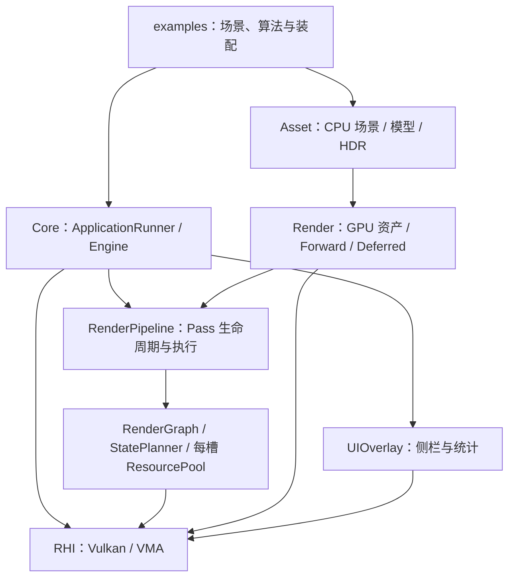

# 当前架构与模块契约

核对：2026-10-28；构建/测试注册边界更新：2026-10-30。依据当前工作区源码，包含未提交实现。本页只描述已实现内容；未来约束与进度见[路线图](../structure/roadmap.md)，操作见[开发与运行](../usage/README.md)。

按需阅读：[所有权](#ownership) · [Runtime](#runtime) · [RHI](#rhi) · [Graph](#graph) · [资产](#assets) · [场景渲染](#rendering) · [UI与诊断](#ui) · [示例边界](#examples) · [限制](#limits)。

<a id="ownership"></a>
## 模块与所有权



| 所有者 | 独占对象或职责 | 借用边界 |
|---|---|---|
| Engine | Window、Instance/Surface/Device、SwapChain、命令池、每槽 CommandList、SyncManager、Pipeline、UI；驱动全局静态 Input 更新 | 给 Pass 传设备与布局；销毁前等待 GPU |
| RenderPipeline | Pass、逻辑 Graph、每槽内部资源池、export lifetime | 外部 Image/Buffer 只借用，不分配或销毁 |
| RenderGraph / StatePlanner | typed handle、声明、依赖、状态计划 | 不提交命令，不拥有业务资产 |
| 示例 SceneDrawSource | SceneData、GPU mesh/material/environment、相机、四 phase Renderer、snapshot | 消费 Pass 借用资产一个提交 |
| ForwardProgram | layout、shader、有限 pipeline cache | Renderer 借用 Program |
| ForwardRenderer | 本 phase 每槽 frame/draw UBO、descriptor | 不拥有 draw 资产或 Graph 附件 |
| Lighting / Display / GBufferDisplay | 各自 pipeline、shader、sampler、每槽参数 | 采样图像归 Graph pool |
| UIOverlay | SidebarState、ImGui backend 与 UI 资源 | Pipeline 只提供内容回调 |

头文件与实现都在 `src/KuEngine`。当前库是一个静态 target，多数依赖 PUBLIC 传播，并未拆为可独立链接的后端模块。

<a id="runtime"></a>
## Runtime、帧槽与生命周期

[ApplicationRunner](../../src/KuEngine/Core/ApplicationRunner.h) 解析运行参数、装配 Engine、归纳析构后的结果。[Engine](../../src/KuEngine/Core/Engine.h) 统一 acquire、record、submit、present；算法通过 Pass 接入。

`EngineConfig::framesInFlight` 默认 2，只接受 1 或 2。三个编号不可混用：

| 字段 | 含义 |
|---|---|
| frameIndex | 轮转的帧资源槽 |
| imageIndex | 本次 acquire 的交换链图像 |
| submittedFrame | 单调递增的实际提交编号，跳过 acquire/resize 不产生提交 |

常规帧等待复用槽 Fence，再回收该槽统计、更新可变参数并录制；正常循环不全设备 idle。acquire semaphore/Fence 按槽，present semaphore 按交换链 image 管理。命令列表、Timestamp Query、Graph 内部图像/Buffer、可变 UBO/descriptor 按槽隔离；不可变 mesh/material texture/Program 可共享。

资产替换、实例编辑、路径切换请求先排队，在安全 update 发布；普通 Shader 参数可在当前 UI 直接更新。涉及共享 GPU 对象的资产替换、编辑容量/管线准备使用 `waitForAllFrames`。resize、recompile、退出可等待全部提交，尚无通用延迟回收。

```text
poll/input → 等待当前槽 → acquire → ViewerLayout
→ UI newFrame → update/安全发布 → UI 控件 → 业务 Graph（含 post-UI ScenePrepare）
→ Runtime Overlay → 外部图像最终状态 → submit → present
```

ViewerLayout 是逻辑窗口、framebuffer、场景 viewport/scissor 与输入命中的唯一映射。展开侧栏预留场景，收起后紧凑统计或重开控件覆盖。普通附件 renderArea 为完整图像，场景 viewport/scissor 限于场景矩形。

resize 在 idle 后重建 swapchain 与相关资源；Graph 构造各槽候选池，relative image 重建、absolute allocation 保留。格式变化重编译相关 Pass/UI，SidebarState 保留。Graph 不发布失败候选；Pass 自身是否候选式准备由其实现保证。

源码：[Engine.cpp](../../src/KuEngine/Core/Engine.cpp)、[SyncManager](../../src/KuEngine/RHI/SyncManager.cpp)、[ViewerLayout](../../src/KuEngine/Core/ViewerLayout.h)、[SceneInteraction](../../src/KuEngine/Core/SceneInteraction.h)。

<a id="rhi"></a>
## RHI：Vulkan 薄封装

基线为 Vulkan 1.3、dynamicRendering、synchronization2、Graphics/Present Queue 与 SwapChain。设备选择优先支持 Compute 的图形队列；Compute 不是所有应用的硬要求，相关 Pass 必须检查能力。

| 类型 | 当前职责 |
|---|---|
| RHIInstance / RHIDevice | Instance、Validation messenger、设备/队列、VMA allocator |
| SwapChain / SyncManager | 交换链 views、帧与呈现同步 |
| RHIBuffer | Buffer/VMA allocation、map/unmap/flush/invalidate |
| RHITexture | 2D Image/View/VMA allocation；sampler 由上层持有 |
| RHIShader | 显式 SPIR-V path/stage/entry；不运行时编译 GLSL |
| RHIPipeline / RHIComputePipeline | Dynamic Rendering Graphics（唯一 V/F）与独立 Compute |
| RHIParameterSet | UBO/SSBO/CombinedSampler/StorageImage 基础绑定与校验 |
| CommandList / ResourceUploader | 常用命令、统计/计时、同步 staging 上传 |

RHITexture 仅 2D/mip1/layer1/sample1，没有通用 ImageView 系统。ParameterSet 每 binding 一个 descriptor，不是反射/bindless。Uploader 每次上传后 queueWaitIdle，纹理最终用途固定 Fragment sampled，适用于初始化与低频更新。

GraphicsPipelineDesc 覆盖当前顶点布局、附件格式与常用 depth/cull/blend；特殊 blend、stencil、depth bias 和其他 shader stage 尚无通用接口。设备创建没有外部 extension/feature 申请入口。

原生句柄仍可用，拥有者保证 GPU 完成后再销毁。Texture/Pipeline/ParameterSet 等关键构造失败路径会回滚，但部分旧 wrapper 未禁止隐式复制，不能视作安全的按值资源类型。features13 返回支持集合，逻辑设备只启用上述两个 1.3 特性；消费者不能把支持自动当作已启用。这些限制本轮未修复。

源码：[Device](../../src/KuEngine/RHI/RHIDevice.h)、[Buffer](../../src/KuEngine/RHI/RHIBuffer.h)、[Texture](../../src/KuEngine/RHI/RHITexture.h)、[Pipeline](../../src/KuEngine/RHI/RHIPipeline.h)、[ParameterSet](../../src/KuEngine/RHI/RHIParameterSet.h)、[Uploader](../../src/KuEngine/RHI/ResourceUploader.cpp)。

<a id="graph"></a>
## Graph：声明、状态与执行

Pass 生命周期是 initialize(context) → setup(builder) → Graph compile/candidate pool → prepare(context)；运行时 update/execute，按需实现 drawUI/onResize。Pipeline 以 unique_ptr 持有 Pass，Graph node 只借用。兼容旧无参 setup 和 execute 重载，析构负责清理，没有 shutdown。

Builder 用 createImage/createBuffer 声明内部资源，importImage/importBuffer 声明借用资源。typed handle 含 index、kind 与全局 graph generation；reset/recompile 后旧 handle 失效。同名资源 kind/ownership/descriptor 必须一致。

ImageDesc 表达 format/usage/aspect、absolute 或 swapchain-relative extent、clear/initial content；compile 只接受 2D/mip1/layer1/sample1。BufferDesc 表达 size/usage/VMA memory use。use/resolve 规范化并检查 image subresource 和 buffer range，planner 能按范围拆分/合并。

访问使用 ImageUse/BufferUse，附件使用 Clear/Load/Store。Undefined 不能首读，LOAD 需要有效内容；内部 Cleared image 首用必须 CLEAR attachment，内部 Buffer 无隐式 clear。显式 ComputeStorageReadWrite 可表达算法读写，重叠的多项隐式读写会拒绝。

资源冲突按 **Pass 注册顺序** 确定方向，再结合 dependsOn 拓扑排序；不是与注册顺序无关的资源版本化调度器。StatePlanner 在 enabled-mask 后检查生产者/消费者、RAW/WAR/WAW、布局与范围，生成 synchronization2 barrier 批次，普通跨 Pass 屏障在 scope 外记录。

每个 attachment Pass 独立 Dynamic Rendering Scope，Compute/Transfer 不得在其中执行。成功录制后才提交 execution state/content shadow；禁用生产者而保留消费者会被内容预检拒绝。

### 内外部资源与导出

内部 allocation 可缓存，但 beginFrame 使内容逐帧失效；没有内部 Preserved/history 资源。每个在途槽有独立 pool 与物理状态。

外部资源在录制前 bindExternalImage/Buffer，传准确对象、尺寸、usage 超集、初始/最终 Stage/Access/Layout 和 contentsValid。调用方保持资源到提交完成并负责图外同步，Graph 不隐式另行提交或转移所有权。

execute 按已声明 use/range resolve 当前资源。allocation generation 或 ImageView 改变后重绑 descriptor，不永久缓存旧裸句柄。

导出须先在 setup 声明，成功 execute 后获取并检查 valid。export 是受 owner/epoch/frameSerial 限制的借用：下一帧、resize/recompile、owner 销毁即失效，不延长 GPU 寿命。当前图像导出校验偏向 attachment STORE，Compute/Transfer 写图像再 export 会被拒绝，尚未修复。

### Callback 与原生命令

CallbackPassDesc 的 name/declare/execute 必需，prepare/nativeContract/expectedStatistics 可选。declare/prepare 接收可变 Parameters，execute 为 const Parameters；recompile 刷新 handles，稳定借用设备。

GraphCommandContext 提供 checked resolve、fill/copy、Compute binding/dispatch。native scope 先声明已知 capability/side-effect，再请求子集；scope move-only，仅 execute 有效。任意裸 Vulkan 命令的真实读写/布局/副作用仍需代码审查与 Validation，系统不能自动识别。

旧对象为 TrustedLegacyObject，不具备 restricted callback 的完整检查边界。当前单图形队列执行 Graphics/Compute，无 Async Compute、queue ownership transfer、aliasing、自动 Pass 裁剪或并行录制。

源码：[Pass](../../src/KuEngine/Render/RenderPass.h)、[Graph](../../src/KuEngine/Render/RenderGraph.h)、[StatePlanner](../../src/KuEngine/Render/RenderGraphStatePlanner.h)、[Pool](../../src/KuEngine/Render/RenderGraphResourcePool.h)、[Callback](../../src/KuEngine/Render/RenderGraphCallbackPass.h)、[CommandContext](../../src/KuEngine/Render/GraphCommandContext.h)。

<a id="assets"></a>
## CPU 资产、配置与 GPU 资源

AssetConfig/AssetPath/SceneLoader/ModelLoader/HDRImage 是 CPU 层，不创建 Vulkan 对象。AssetPath 规范 resources-root 相对路径并生成去重键；SceneLoader 完整校验候选后发布。单次加载按规范模型路径去重为稳定 MeshHandle，SceneInstance 保存 TRS、material reference/override 和 scalar-only MaterialSlot。

Scene TRS 为 T * Rz * Ry * Rx * S，值有限、scale 各轴 >1e-5。glTF 内部节点变换导入时烘焙到顶点，不是可编辑节点树；位置、逆转置法线/切线和 AABB 同步转换。

ModelLoader 接受 .gltf/.glb triangles，索引统一 uint32；无索引生成连续索引，缺法线重建。顶点保留 position/normal/tangent/uv0/uv1；五 PBR 贴图各自 UV/KHR_texture_transform、Unlit、alphaMode/cutoff/doubleSided 均保留，图片转 RGBA8。MR/AO 保持独立，不任意重打包。

HDRImage 严格检查尺寸/溢出/像素，提供线性 float RGBA；当前支持 lat-long .hdr。没有 cubemap/EXR/压缩纹理、skin/animation/morph、完整 sparse accessor 或跨场景缓存。

renderPath 可省略为 Forward，存在时必须精确小写 forward/deferred；CLI 优先但不跳过坏 JSON。显式 scene 不存在或有坏引用/格式会初始化失败；缺失的旧默认 scene 才可兼容 fallback。显式 scene 的 root 优先祖先 resources，否则 scene 父目录；无 environment 创建完整黑 fallback。

MaterialConfig 的 has* 区分未指定/显式覆盖；texture binding source 选择 glTF 内置纹理或禁用，不支持任意外部纹理文件。legacy ORM 只在独立 MR/AO 未指定时映射。Registry 虽复制到运行目录，未承担自动发现。

GpuModelAsset 拥有单 GpuMesh；材质 variant 按 descriptor 资源差异去重，标量/UV 在 per-draw 数据；Environment 拥有纹理/sampler/descriptor。GPU 上传后释放 CPU 顶点/索引/贴图/HDR 像素容量，保留 bounds、primitive/material/instance 编辑元数据；此时 SceneData.valid 的完整 payload 语义不再成立。

Mclaren 模型/HDR/编辑请求在安全点构建完整候选，准备 pipeline/容量后才发布；失败保留当前场景、相机、路径/generation 与统计。共享资源替换等全部在途帧完成。成功模型替换创建单节点 replacement-model、instance/slot 选择重置0，不保留旧实例编辑。

Clear Environment 构建同 layout 的 1×1 RGBA32F 黑 GPU 候选，成功才清 active HDR、关闭 sky/env 并释放旧环境，不删除用户文件。active HDR state 不等同于初始 SceneData.environment。实例 scalar/TRS 编辑复用 mesh/texture/descriptor，不重新上传或重算导入 fit。

源码：[AssetConfig](../../src/KuEngine/Asset/AssetConfig.h)、[AssetPath](../../src/KuEngine/Asset/AssetPath.h)、[Scene](../../src/KuEngine/Asset/Scene.h)、[Model](../../src/KuEngine/Asset/Model.h)、[GPU Asset](../../src/KuEngine/Render/GpuModelAsset.h)、[PBR Resources](../../src/KuEngine/Render/PBRResources.h)。

<a id="rendering"></a>
## 公共 Forward、Deferred 与输出

RenderPath 与 ShadingModel 独立，PBR/Unlit 与 Opaque/Mask/Blend、doubleSided 组合分派。ForwardProgram 固定 set0=material、set1=frame、set2=environment、set3=draw；Renderer 管理对齐动态 per-draw UBO、容量检查与按槽数据。

post-UI ScenePrepare 每提交生成稳定 snapshot；Background/Opaque/Geometry/Blend 四套独立 Renderer UBO，Lighting 自身帧 UBO，避免 phase 互相覆盖。所有消费者显式依赖 Prepare，检查 enabled/stale snapshot。

```text
Prepare → Background CLEAR（天空或清屏）
  → Forward Opaque/Mask 或 Deferred Geometry → Lighting
  → Forward Blend → 唯一普通 Display → Runtime UI → Present
```

两路径共用 Graph-owned ForwardSceneColor RGBA16F 与 ForwardSceneDepth；deferredSceneColorName 是共享颜色名别名。Background 清颜色，Opaque/Geometry 清深度并 STORE，Blend LOAD 深度、test/no-write、按对象中心稳定排序，不解决任意透明相交/OIT。

Deferred 四附件均 RGBA16F，location 与 Lighting binding 顺序固定，世界位置直接存 half、不从深度重建，合计32B/pixel（不含深度）：

| location | 名称 | RGB | A |
|---|---|---|---|
| 0 | GBufferBaseMetallic | 线性 base | metallic |
| 1 | GBufferNormalRoughness | 世界 normal | roughness |
| 2 | GBufferPositionModel | 世界 position | Empty=0、PBR=1、Unlit=2 |
| 3 | GBufferEmissiveAo | 线性 emissive | AO |

Geometry CLEAR/STORE 四 MRT，只接收 Opaque/Mask，Blend 分流 Forward。Lighting texelFetch 表面，Empty discard 保留背景；PBR 用方向/最多四点光和基础环境，Unlit 输出 base+emissive。Forward/Geometry 共用 material_sample，Forward/Lighting 共用 scene_frame/surface_lighting。

普通 SceneColor 保留 >1 线性值，唯一 Display 做曝光/Reinhard/format-aware sRGB，UI 后合成。UNORM 手动编码，sRGB attachment 硬件编码，不重复编码。完整 IBL 预滤波/BRDF LUT 与 HDR 显示器输出未实现。

ScenePathControl 借用静态分支 Pass，request 后下一安全 update 一次发布 enabled-mask，不上传资产/重编译整图。无 Deferred 能力时禁用或拒绝显式请求，正常切换保留资产、相机、材质、灯光和 UI。

GBufferDisplay 直接采样 MRT 替换普通 Display，Geometry/Lighting/Blend 仍执行。八视图是 base/metallic/normal/roughness/position/shading code/emissive/AO。normal 映射 n*.5+.5，position 固定 [-2,+2]→[0,1]，scalar 灰度、emissive 截断；Empty 黑、PBR 红、Unlit 绿、未知紫红。只 clamp/单次显示编码，无曝光/tone map、不读 Blend 后颜色。Forward 禁用 debug 并恢复 Scene。

源码：[ScenePasses](../../src/KuEngine/Render/ScenePasses.h)、[Program](../../src/KuEngine/Render/ForwardProgram.h)、[Renderer](../../src/KuEngine/Render/ForwardRenderer.h)、[DeferredCommon](../../src/KuEngine/Render/DeferredCommon.h)、[Lighting](../../src/KuEngine/Render/DeferredLightingPass.cpp)、[GBufferDisplay](../../src/KuEngine/Render/GBufferDisplayPass.h)。

<a id="ui"></a>
## UI、日志与统计

UIOverlay 独占右侧栏，Pipeline 提供 Pass/Graph 内容并按 Pass 索引隔离 ImGui ID；Pass 仍可直接依赖 ImGui。Input/SceneInteractionGate 处理场景命中、UI capture、失焦与 neutral handoff。Mclaren Orbit/FreeFly 属示例层，Cube 未复用 FreeFly。

FPS/Frame 是当前主循环样本；CPU/GPU/Draw/Vertices 来自同一 Fence-completed submit。pending 按槽存储，晚完成旧槽不回退快照。业务 draw/vertices 通过封装记录，索引绘制计 indexCount×instanceCount，不是唯一顶点或真实 VS 调用；ImGui 不计入。

CPU 是成功 acquire 后至 submit 返回的墙钟跨度，含 Pass update/UI/录制，不含事件处理、Fence/acquire 等待和 present；GPU 是命令列表两时间戳之间的跨度，两者不是同一量测范围。

CommandList 两个 Timestamp Query 记录全命令跨度，按 timestampPeriod/valid bits 换算并处理回绕；完成后用 availability 读，不用 WAIT_BIT 额外阻塞。状态为 Unsupported/Waiting/Available，无有效数据 UI 为 N/A。没有逐 Pass profiler，GPU 时间也不是利用率或纯 Shader 时间。

spdlog/fmt 提供日志，KU_DEBUG_BUILD 控制配置级别。VK_CHECK 将失败转异常，Validation callback 不让异常越过 C ABI。Debug 在可用时启用 layer/debug utils，共享 tracker 保留析构前捕获的 warning/error，Runner 在 Runtime 销毁后归纳。

参数错误退出2，初始化失败1，捕获的 Validation error 为3；要求 Validation 而不可用为77（跳过）。Release 默认不请求/捕获 Validation，其运行成功不能替代 Debug SyncVal。

源码：[UI](../../src/KuEngine/UI/UIOverlay.h)、[Statistics](../../src/KuEngine/Core/FrameStatistics.h)、[Commands](../../src/KuEngine/RHI/CommandList.h)、[Log](../../src/KuEngine/Core/Log.h)、[Validation](../../src/KuEngine/RHI/VulkanValidation.h)。

<a id="examples"></a>
## 示例装配与专用所有权

Triangle/Cube 验证 draw/push constants/输入，Alpha3Pass 验证多 Pass 附件。Mclaren/ForwardReuse/CornellBox 共享 SceneDrawSource 与两渲染分支，场景内容和编辑由示例拥有。

GraphResourceProbe 链为 ImageClear → BufferFill → native Copy → Compute Copy → SampleDraw → PostDrawCopy。固定128B、32uint copy、indexed-indirect蓝三角；不是复杂生成几何或 host 整 Buffer 数值验证。

CornellBox 自行生成 MeshData/MaterialData，单 mesh 上传并复用公共 Deferred/PBR；顶灯 emissive 与四点光分别表达，不是面光源积分/GI。可选读回对象拥有每槽 staging，Graph 只借用，Fence 后 host inspect。

VolumetricIntegration ScenePass 拥有 pipeline/shader/settings，48B push constants；Graph 每槽拥有 RGBA16F SceneColor。DisplayPass 拥有 sampler/pipeline/每槽 descriptor，曝光1、无 tone map，保留原 pow(1/2.2)。UNORM 写 encoded 值；sRGB 先 inverse-sRGB 再硬件编码。

体积链 Scene → Display → 可选 Readback → Runtime UI；Display/Readback 直接读线性 SceneColor。Readback 自有每槽 staging，等槽 Fence 后读取；resize/recompile/退出 drain 包括尾帧，析构期导出错误通过共享 CaptureReport 使 main 失败。来源、差异和格式见[示例手册](../usage/examples.md#volumetric)。

<a id="limits"></a>
## 当前能力边界

- 当前为单队列、1/2帧实验框架。history、mip/cubemap/3D、aliasing、多队列、并行录制、通用 retire、批量上传、反射/热重载未具备。
- Pipeline 同时处理图执行与 ImGui Graph Debug；Engine 整合 Viewer，没有完整 headless backend 或独立可链接模块边界。
- 旧 PBRRenderer 仍被构建/公开，当前三个场景消费者使用 ForwardProgram/ForwardRenderer；新增场景优先参考公共新路径。
- CPU 测试覆盖声明、范围、状态、资源池/回滚、配置与数学契约，不替代真实 GPU/Validation/画面。既有验收及未运行边界见[历史记录](../structure/archive/README.md#verification)，2026-10-28文档整理没有重验 Runtime。


## 构建与CTest注册边界

根CMake管理两个默认OFF的注册开关：KUENGINE_ENABLE_GPU_SMOKE_TESTS开启GPU清单；KUENGINE_ENABLE_EXTENDED_GPU_TESTS仅在GPU总开关ON时可启用。tests/CMakeLists在默认GPU模式保留3CPU与13项只启动Mclaren/CornellBox的GPU检查；其他例、混合矩阵和Triangle负例仅扩展注册，扩展恢复原40项。GPU关闭只有3CPU；默认不查找Python，扩展体积专项才要求Python3。普通configure preset显式重置EXTENDED=OFF以清理旧cache。

本次改变的是构建/测试注册选择，Runtime、Graph、runner/checker及像素/同步判据未改。注册不等于实际运行；默认范围与专项命令见[验证方法](../usage/README.md#verification)，具体清单以[tests/CMakeLists](../../tests/CMakeLists.txt)为准。
