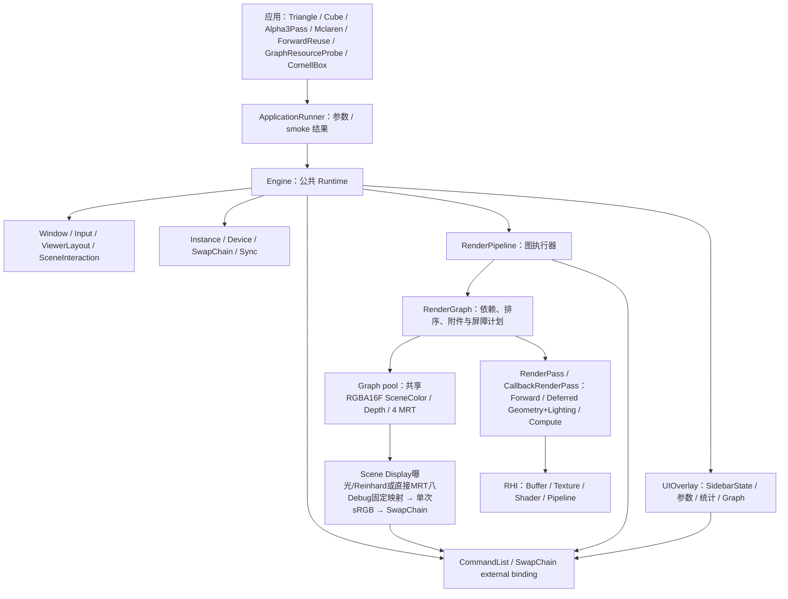
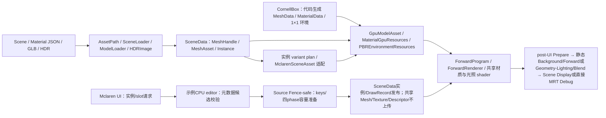

# KuEngine 当前宏观架构

核对2026-10-11：WP01/02/A/B既有门禁已闭；最终C QA ACCEPTED + DOCUMENTED、REQ-01～13首轮范围已验收，WP03/M4已由Lead最终审计闭环（DONE），M5未开始。C只读审计/验收无新增Runtime接口或实现。

## 定位与当前能力

KuEngine 是基于 Vulkan 1.3 的图形算法验证框架。当前由一个公共 Runtime 承载七个示例，具备 Pass/Callback 调度、图像附件执行、Graphics/Compute 图资源、glTF/PBR 输入、UI 参数控制与基础性能观测。

CMake/版本宏仍标为 0.1.0；历史文档中的 v0.2/v0.3 是迭代阶段称谓，本页不据此宣布新版本发布。

## 运行结构

Runtime拥有公共生命周期；Pipeline拥有Pass/Graph/internal pool。Engine只绑定外部SwapChainColor，共享ForwardSceneColor/Depth与四MRT由pool拥有（DeferredSceneColor兼容名为共享Color别名），无RuntimeDepth。每个attachment Pass独立Dynamic Rendering Scope，屏障在Scope外。ViewerLayout统一逻辑输入与framebuffer viewport；业务renderArea完整、viewport/scissor限场景，尾部UI绘制完整附件。

## 数据与资源流

AssetPath规范路径，SceneLoader以稳定MeshHandle连接去重Mesh与TRS/material override实例，完整候选才发布。HDR loader给出严格CPU RGBA float。Mclaren、ForwardReuse 与 CornellBox 三例共享公共GPU mesh/material/environment，Program拥有layout/shader/cache，coordinator拥有各phase Renderer独立frame/draw UBO/descriptor。post-UI Prepare只一次构建snapshot，Renderer在各phase执行时写自己的UBO；Background、Opaque或Geometry/Lighting、Blend、Display分开Graph节点。模型/HDR替换在单帧Fence-safe update完整候选成功后发布，失败保留state/相机/统计；首次初始化加载，ready recompile不重置状态。snapshot借用资产一提交，非多帧retire。OrbitInspect/FreeFly仍属Mclaren示例相机，交接要求中性输入。

B的公共SceneMaterialSlot仅标量无ImGui，MclarenSceneEditor是CPU queue/candidate；DrawRecord保留实例/primitive/slot身份，Source准备成功才发布，另一实例/槽保持，共享mesh/纹理/descriptor不重复上传。releaseCpuMesh只释放capacity-zero顶点/索引/texture/HDR像素，保留bounds/primitive/material/instance；SceneData.valid仍完整导入语义。导入fit缓存保持相机，SceneData没有聚合bounds。

严格`--scene`根为祖先resources，否则显式scene父目录；缺值/重复2，错误scene/model/material/HDR初始化1，显式不退默认车/HDR。无环境为有效黑fallback；无参数旧默认scene缺失才回退，已有无效scene失败。真正Clear独立请求→同layout完整1×1黑GPU候选→Fence-safe发布空active path/gen++/sky-env false→旧GPU reset；失败保留，Load恢复。初始SceneData.environment与activepublishedHDR不同，寿命token只是示例局部证据。

## 查看器与可观测性

成功侧栏Model Load不是资产保持操作：MclarenSceneAsset构建单节点replacement-model新SceneData，发布后instance/slot归0，之前双实例编辑被替换；失败保留当前模型。普通path/HDR/resize/recompile保持编辑。最终C分别记录A3双实例gen19与fresh-default SessionB模型导入，不宣称跨进程保持。Clear完整黑环境也不意味全viewport黑，直接光照/灰清屏仍有效。

UIOverlay 是唯一顶层右侧栏，展开态包含 Performance、Parameters / Scene、Render Graph；收起后可显示紧凑 Performance，隐藏后仍有重开控件。Pass 只输出内容，Pipeline 用 Pass 索引隔离 ImGui ID。侧栏状态变更在下一帧快照生效，避免单帧中 UI、渲染和输入看到不同布局。`SceneInteractionGate` 以活动窗口、ImGui 捕获、场景逻辑矩形、覆盖 UI 排除和 Input epoch 控制拖动/滚轮；Cube 和 Mclaren 共享它，比例也取同一场景 viewport。Mclaren 已移除第二套局部视口；FreeFly 进一步以 UI 键盘/文本捕获、场景右键焦点与 held-input neutral 规则隔离 WASDQE，Cube 不接入该模式。

FPS/Frame 来自当前主循环；CPU、GPU、Draw Calls、Vertices 来自同一个已完成 submitted frame。Engine 在 submit 后暂存 CPU 与业务计数，Fence 完成或退出 device idle 后结合 Timestamp 发布快照。GPU 状态分为 Unsupported、Waiting、Available；Draw/Vertices 使用饱和 `uint64_t` 累加。Debug 构建中，Instance 仅在 Validation Layer 和 Debug Utils 可用时捕获 Vulkan 回调并写入统一日志；共享 Tracker 的 warning/error 累计值可跨 Instance 销毁读取，ApplicationRunner 会将非零 error 映射为失败退出码。显式 smoke 模式额外要求可捕获 Validation，并将缺少驱动、设备、Layer 或 Debug Utils 报告为 skip；这些计数仍不显示在 UI。Graph Debug UI 展示依赖、屏障和执行摘要。

这提供单帧量级的观测；尚无性能曲线、每 Pass Query、结果导出或可复现实验框架。具体统计口径见 [UI 设计](../design/05-ui-layer.md)。

## 已实现与现有限制

| 领域 | 当前实现 | 当前限制 |
|---|---|---|
| Runtime | 七示例统一帧循环、深度 format 选择、按提交帧数停止、自动 resize/recompile、completed-submit 统计 | 单帧并行；重建使用 deviceWaitIdle，最小化/恢复未纳入自动 smoke |
| Graph | typed Image/Buffer descriptor/handle、internal pool、candidate compile/resize、first-use/LOAD/export、显式 use、CPU state planner、synchronization2 image/buffer barrier、Compute callback/checked resolver/受约束 native scope、Forward SceneColor/Depth/display | 无别名/多 Queue；内部内容不跨帧保留；不自动检测任意裸 Vulkan 命令 |
| RHI | Vulkan/VMA 薄封装、同步上传、动态渲染、显式 ShaderDesc、Compute Pipeline/ParameterSet、可用性检测后的 Validation/Debug Utils 消息记录 | 旧式 Barrier 仍有兼容入口，上传 queueWaitIdle，无 Async Compute；部分同步 wait 返回值尚未统一检查 |
| Forward/Deferred/资产 | 共享HDR/透明/天空；strict配置/scene/CLI优先、Fence-safe静态mask、四phase UBO、直接MRT八views；Mclaren实例/slot编辑与完整黑GPU Clear安全发布/旧GPU释放 | 首轮C QA已验收，非通用ECS/编辑器；对象中心排序非OIT；完整IBL/多帧retire非首轮 |
| UI / 查看器 | 唯一右侧栏、参数/Graph/统计、逻辑输入矩形和 framebuffer 场景 viewport；Mclaren OrbitInspect/FreeFly | 单 Context；UI 非普通 Graph Pass；FreeFly 仍为示例层，Cube 未接入，尚无多窗口 |
| 测试 | CPU/七app/有界HDR与八rawMRT/实例编辑/资源保留；A3完整双实例与独立B HDR/model/真实resize；普通true minimize/restore | 非公共验证状态机/历史像素平台；用户自测与重复豁免分列、专项held stress NOT RUN；aggregate配置隔离，部分legacy prefix共享 |

## 源码和测试组织

公共库在 src/KuEngine，下分 Core、RHI、Render、Asset、UI；示例在 examples 的七个示例子目录，资源在 resources。

CTest 的 core_tests 覆盖 Engine/FrameStatistics/Graph/AssetConfig/ApplicationRunner/PBR/Validation、SidebarState、ViewerLayout、SceneInteraction、Scene/AssetPath/HDR/PBR 资产计划、Mclaren replacement、Graph state/Callback 与 Forward Graph targets CPU 语义；mclaren_camera_tests 覆盖双模式 `OrbitCameraController`。M3-WP04 QA 在独立 Debug/Release 构建中通过 Debug core124/camera32/定向37、完整 CTest19/19，以及 SyncVal 下 ForwardReuse 二次 compile 9/45、Probe 二次 compile 后 resize 1/3、Mclaren resize 91/9,202,884，均 errors=0；权威 Release CTest 为 3 Passed / 16 Skipped / 0 Failed。Release direct 的 ForwardReuse、Probe 二次 compile、Mclaren、Triangle 另行通过；require-validation/缺 Layer 的 77 是预期 skip。没有 RenderDoc、readback pixel baseline、soak、真实 live-format 强制或物理非等比 DPI 证据。

M4-WP01 独立 QA 最终 ACCEPTED（2026-10-08）：fresh Debug/Release build、两配置 core129/camera32/定向26、Debug SyncVal CTest22/22，必要脚本 ignore 例外修复后窄复验3/3；Release CTest3 pass/19 expected skip，另行 direct Deferred/Forward/Mclaren/Probe 通过。实际 RTX 4060 Ti 窗口和独立 GPU readback 检查编码/Mask/深度/零光/方向光/点光/Unlit 稳定/背面/resize/recompile；Deferred8/36、Forward9/45。未运行专用 Deferred normal-map GPU fixture、低能力实机、强制 live-format、soak、RenderDoc、历史精确像素比对或可靠 held 手势；共享法线源码与 Mclaren Forward 回归不代替专用证据。操作与可定位证据见 [回归说明](../usage/regression-checks.md)。

一般 GPU Smoke 只检查启动、提交、退出、有限 resize 和诊断；Deferred 专用测试额外检查实际 GPU readback，不把它推广成通用画面/交互/最小化验收。未来目标单独维护在 [路线图](roadmap.md)。

最终C（2026-10-11）`build/qa-m4-wp03c-final/qa-report.md` ACCEPTED首轮REQ-01～13；C无代码变更，无新Runtime API。新独立Debug build/core137/composite40，五可视示例13原图、A3同PID63840（Q6+recovery72+final001–037）normal0/SMOKE3562615/error0；fresh-default SessionB PID80472（final038–079）HDR Clear/Load、实际2560×1369→1280×720、model request5成功/reset selection0与bad request6保留，normal0/SMOKE401459/error0。原A49/A2异常0xC000013A保留历史，不作pass。B两配置core137/composite40/DebugSyncVal31与20真实ReleaseGPU组继承冻结同输入，ReleaseCTest3pass28skip77不是GPU通过，不称C全部重跑。

C独立持续Orbit/释放/UI-origin/W/S、普通true minimize/restore与真实resize有证据；WASDQE/right-held look/UI文本capture/失焦USER-SELFTESTED、重复人工SKIPPED为用户明确程序修订，不称全部独立实机。18controller tests包含在composite40；新diagonal/startup/mode/reset/epoch-held stress/exact physical rates NOT RUN。低caps/OOM/device-loss/live-format/soak/RenderDoc未运行。Probe固定fill/native128B/compute32uint/sampledraw/postcopy，无host wholebuffer数值读回，Compute prepare非transactional恢复，native-afterexecute仅源码核对且无专项永久误用测试。完整证据/限制见[回归](../usage/regression-checks.md)，现有接入见[开发渲染特性](../usage/developing-render-features.md)。C DOCUMENTED、最终M4 Lead闭环完成，M5未开始。

上述WP01计数/临时输出和当时未运行法线fixture是历史验收差异，不是当前限制。WP02正式QA`build/qa-m4-wp02/qa-report.md`：独立Debug/Releasebuild，各core132/camera32；DebugSyncVal29/29，Release3Passed26Skipped（非GPU通过），另26真实GPU22checker+6补充。四真实app/path窗口与maximize、固定ROI/阈值、线性Blend/HDR>1/深度不写/曝光不影响HDR、真实UNORM/SRGB、normal/UV与sky-env四组合通过。普通ForwardReuse9/45或10/48，Mclaren91/9202884或92/9202887；probe另2/6。最终Debug per-case为hdr-debug-final；强制live-format/soak/RenderDoc/低能力GPU/完整手动camera-minimize未运行，后者归WP03。

WP03-A正式`build/qa-m4-wp03a/qa-report.md`：fresh Debug/Release全build0，各core137/camera32；Debug显式SyncVal30/30无skip，Release3pass27skip另19真实GPU groups(paths8/200+config、HDR18/22、lights4、replacements7、apps6、extras3)。官方两例GUI24图操作路径/八views/sidebar resize，exit0/errors0；手动FreeFly/FOV45.926/exposure1.747不混同smoke值。71input hashes冻结。Core只新增const completed-statistics getter，不改调度。Shader bin/$<CONFIG>与aggregate evidence隔离已验，部分legacy prefix仍共享。此为A历史局部证据。

历史B局部依据（2026-10-10；段末C未运行/未验收仅为当时状态，最新最终C见前述段落）：最新B正式独立`build/qa-m4-wp03b/qa-fix-01/qa-report.md` ACCEPTED(2026-10-10)：两配置fresh build0，各core137/camera40；Debug显式SyncVal31pass/0skip/0fail actual0 190.13s，Release3pass28skip/0fail actual0 12.17s(77非GPU通过)，另20真实GPU组actual0。B每layout29samples/16edits，两layout每配置58；两实例全部TRS/scalar/Unlit-PBR与独立geometry/model/world-pos/1px ROI参考、非空Unlit10263RGB、原阈值通过。viewport导入非黑/Clear黑/failed bytes保留和旧GPU reset1通过。最终同一官方GUI33原图actual app0/SyncVal errors0，87inputs不变；warning1是系统EOSOverlay重复loader。早先QAB-01 REJECTED、原fullGUI退出unknown、partialGUI后来0、final02 locked blocked保留为历史，不拼接为最终通过。C持续held/text/focus/minimize、低caps/物理OOM/device-loss/forced live-format/soak/RenderDoc未运行；C/REQ整体/WP03/M4未验收，M5未开始，部分同步wait返回值检查仍未统一。

2026-10-21 新增 CornellBox / REQ-15 独立示例，QA ACCEPTED、文档已同步；M5未开始，M4历史验收不重开。CornellBox 代码建立房间、两旋转盒和 emissive 顶灯，直接上传 MeshData，不经过导入器/JSON/外部 HDR。复用公共 SceneDrawSource、四 phase UBO、Deferred/Forward、HDR Display、侧栏和 Runtime，Graph 仍拥有附件；简化 PBR 采用四点光和中性环境，无阴影/GI/真实面积积分。默认1280×960，Deferred10/114、Forward9/111，相机为UI yaw/pitch/distance。可选有限Deferred GPU half读回是示例证据工具，不是公共截图平台。

独立 [CornellBox QA](../../build/qa-cornell-box/qa-report.md)：Debug定向CTest7/7无skip、显式SyncVal0error，两配置core142/142，3组真实Release GPU与独立ray/plane/OBB像素/真实GUI通过；当前注册33项未全跑，其余NOT RUN见 [回归](../usage/regression-checks.md)。
